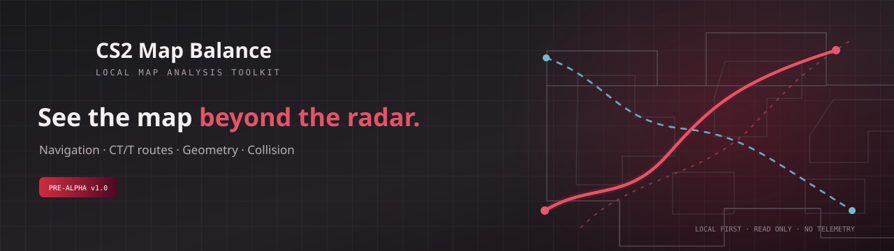
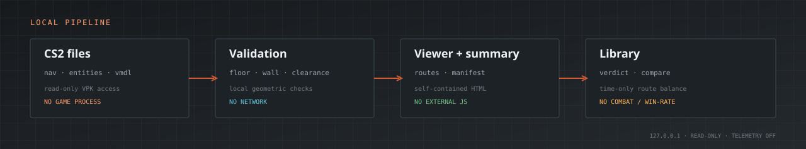
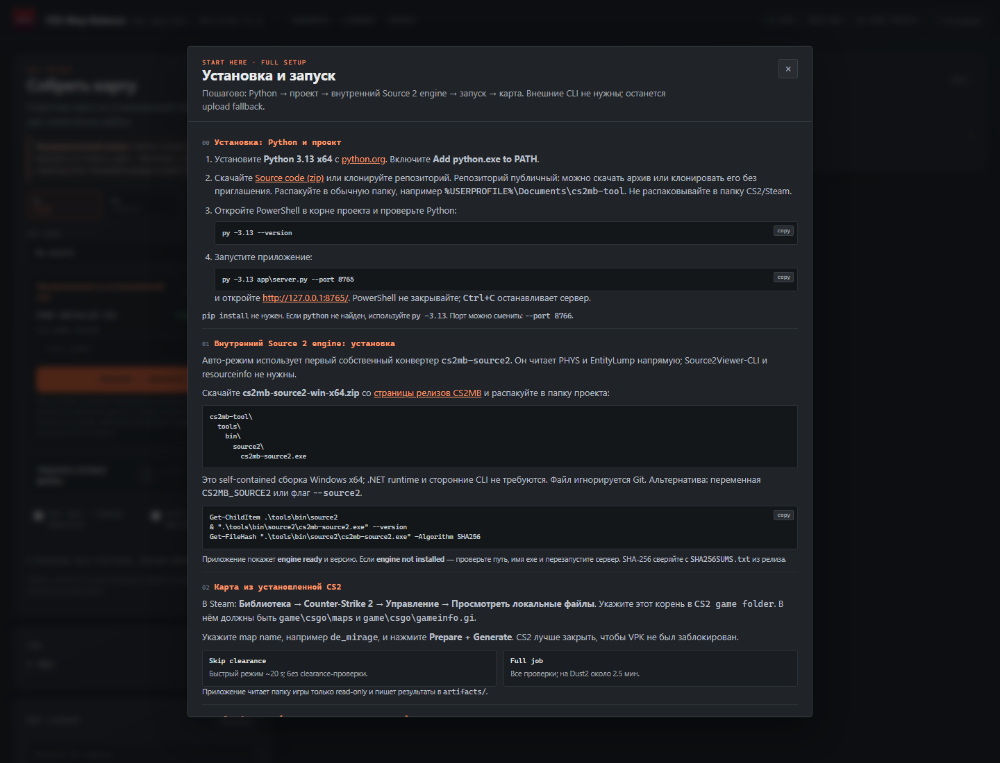
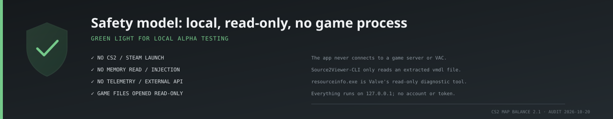

<p align="center">
  <b>English</b> · <a href="README.ru.md">Русский</a>
</p>

<p align="center">
  
</p>

<h1 align="center">CS2 Map Balance</h1>

<p align="center">
  A local, read-only research tool for Counter-Strike 2 map geometry, navigation,
  collision, route timing and reproducible map comparison.
</p>

<p align="center">
  <a href="https://github.com/Shtoblam/cs2mb-tool/archive/refs/heads/main.zip"></a>
  
  <a href="https://github.com/Shtoblam/cs2mb-tool/actions/workflows/tests.yml"></a>
  
  <a href="docs/SECURITY.md"></a>
</p>

<p align="center">
  <a href="https://shtoblam.github.io/cs2mb-tool/"><strong>Project website ↗</strong></a> ·
  <a href="https://github.com/Shtoblam/cs2mb-tool">GitHub repository ↗</a> ·
  <a href="https://github.com/Shtoblam/cs2mb-tool/archive/refs/heads/main.zip">Latest source ZIP</a> ·
  <a href="README.ru.md">Русская версия</a>
</p>

> [!WARNING]
> **The current CT/T indicator is a preliminary route-time signal, not a competitive balance verdict.**
> It compares estimated travel time along navigation routes from spawns to common targets. It does
> **not** simulate enemy encounters, firefights, utility, line of sight, player decisions, rotations
> under pressure or round outcomes. A value such as `CT +8.9s` is a reason to investigate, not proof
> that a map is CT-sided or a prediction of win rate.

## What this project is

CS2 Map Balance turns read-only Counter-Strike 2 map resources into validated,
inspectable data and uses that data for route, movement and comparison analysis.

It is intentionally **not merely** a map viewer, a shortest-path demo or a
competitive predictor. The project separates seven layers that must not be treated as
interchangeable:

| Layer | What the project uses |
|---|---|
| Visual | Render assets, optional reference only |
| Geometric | Coordinates, polygons and triangles |
| Collision | `world_physics` glTF, floors, walls, clearance |
| Navigation | Directed nav areas, connections, one-way links, components |
| Movement | Measured speeds and a calibrated straight-line model |
| Scenarios | Spawn-to-target rush and split time envelopes |
| Balance | A time-only comparison of route estimates |

Every result should be read with the layer that produced it in mind. See
[docs/PROJECT.md](docs/PROJECT.md) for definitions and
[docs/ARCHITECTURE.md](docs/ARCHITECTURE.md) for the full architecture.

## Current capabilities

- Read-only VPK, NAV and entity extraction from a local CS2 installation.
- Browser upload/drop of `.nav`, entity `.txt`, physics `.gltf` and `.bin` files.
- Directed navigation graph with one-way links, components and z-aware lookup.
- Generated self-contained viewer with representative and all spawn-to-target routes.
- Collision floor, wall and clearance reports.
- `AK a-b s` route-time range, vertical-transition and `J+` jump-budget indicators.
- Local map library with a preliminary CT/T route-time indicator and side-by-side comparison.
- `manifest.json` with SHA-256 input and glTF sidecar hashes.
- Loopback-only local server with upload limits, path allow-listing, origin checks and job timeout.

<p align="center">
  
</p>

## How the pipeline works

```text
CS2 installation (read-only)
  map VPK -> nav / entities / world_physics.vmdl_c
          -> resourceinfo.exe (entity dump)
          -> Source2Viewer-CLI (physics glTF + .bin)
          -> local validation (nav, floor, wall, clearance)
          -> viewer + summary + SHA-256 manifest
          -> local map library / comparison
```

The same pipeline is available from the local web app and from the command line
(`tools/auto_generate.py`, `tools/prepare_map.py`). Analysis reads prepared data;
it does not silently re-read game files. Visualization never changes analytical
results.

## Implementation status

| Area | Status |
|---|---|
| Map intake, NAV parsing, entities, viewer, map library | Implemented and exercised on nine maps |
| Collision floor/wall/clearance diagnostics | Implemented; several anomaly classes remain under triage |
| Straight-line movement model and route-time range | Implemented from single-run in-game measurements; not demo-tick calibrated |
| Rush and split time envelopes | Implemented as time-only scenarios; no blocking or encounters |
| Line of sight, detection and encounter timing | Not implemented (Release 2.2) |
| Combat, utility, economy and win-rate prediction | Not implemented; deliberately deferred |
| Full 3D visualization | Not implemented; the viewer is 2.5D/SVG |
| Internal Entity/PHYS parsers | Research (Release 3.0); external tools remain in the main path |

The current application version is [`pre-alpha v1.0`](VERSION). This is a
fresh repository baseline under the `cs2mb-tool` name; the historical release
notes remain in [docs/releases/](docs/releases/) as project history.

## Important limitations

- Navigation is a bot abstraction, not exact player collision.
- Route distance is not travel time, and travel time is not match balance.
- The movement model covers straight-line ground motion only; turning, stairs,
  ramps, landing, ladders and air movement are not calibrated.
- Collision extraction may miss static props, dynamic doors and breakables.
- The route-time indicator has no confidence interval, encounter model or
  win-rate meaning.
- The nine-map table below is historical evidence from the recorded alpha batch,
  not a fresh validation of every resource on the current game build.

## Quick start

Requirements: **Windows 10/11 x64**, **Python 3.13 x64**, no `pip install` step.
CS2 is optional for the upload path; Source2Viewer-CLI is optional if you already
have a physics glTF + `.bin`.

```powershell
git clone https://github.com/Shtoblam/cs2mb-tool.git
cd cs2mb-tool
py -3.13 app\server.py --port 8765
```

Open <http://127.0.0.1:8765/>. Keep the server on loopback.

For the complete installation, Source2Viewer-CLI setup and troubleshooting guide,
read **[docs/SETUP.md](docs/SETUP.md)**. To extract map files manually, read
**[docs/GETTING_FILES.md](docs/GETTING_FILES.md)**.

<p align="center">
  
</p>

## Tested map batch

These values were recorded during the alpha batch on CS2 build `25966348`
(October 2026). They are preserved as historical evidence; they are not a claim
that every map resource has been revalidated on the current build.

| Map | Areas | Edges | Floor | Wall flags | Routes | Route-time indicator* |
|---|---:|---:|---:|---:|---:|---|
| de_dust2 | 2242 | 6275 | 98.77% | 2/6091 | 90 | CT +8.9s |
| de_nuke | 3040 | 7676 | 99.27% | 0/7334 | 80 | CT +5.2s |
| de_train | 2154 | 5454 | 99.39% | 30/5229 | 56 | CT +10.5s |
| de_vertigo | 2105 | 5321 | 99.45% | 4/5131 | 60 | CT +7.0s |
| de_mirage | 2544 | 6381 | 99.06% | 4/6069 | 99 | CT +6.4s |
| de_inferno | 2738 | 7068 | 99.54% | 2/6922 | 120 | CT +8.0s |
| de_ancient | 1969 | 5085 | 98.73% | 0/5009 | 72 | CT +8.5s |
| de_anubis | 2633 | 6877 | 97.34% | 2/6750 | 96 | CT +7.3s |
| de_overpass | 3938 | 10016 | 97.71% | 0/9859 | 88 | CT +14.0s |

`*` Time-only heuristic based on median low route estimates across common
targets. Positive CT means only that the estimated CT approach is faster under
the current assumptions. It is **not** proof of a side advantage.

Full clearance was exercised on Dust2 and Nuke; the other maps in the batch used
`Skip clearance`. See [docs/MAP_DATA.md](docs/MAP_DATA.md) and
[docs/VALIDATION.md](docs/VALIDATION.md) for methodology and anomaly notes.

## Security and privacy

The project is a **local file analyzer**. It does not launch CS2 or Steam, attach
to a game process, read or write game memory, inject code, automate gameplay,
contact game servers or anti-cheat, or send telemetry.

- Server binds `127.0.0.1` by default; non-loopback binding requires an explicit flag.
- Uploads are limited by count, size and extension; paths are normalized and allow-listed.
- POST requests have an origin guard; jobs have a timeout.
- The generated viewer is self-contained and is served with a restrictive CSP.
- The intake UI sends a CSP response header and matching meta policy, with framing and MIME protections.
- Generated map data, uploads and extracted resources stay out of Git.

<p align="center">
  
</p>

Read the full model in [docs/SECURITY.md](docs/SECURITY.md) (also available in
Russian: [docs/SECURITY.ru.md](docs/SECURITY.ru.md)). No tool can promise Valve's
future policy; these statements describe this code and its documented dependencies.

## Documentation

The complete documentation index is **[docs/README.md](docs/README.md)**.

- [Setup and troubleshooting](docs/SETUP.md) · [Настройка](docs/SETUP.ru.md)
- [Getting map files](docs/GETTING_FILES.md) · [Получение файлов](docs/GETTING_FILES.ru.md)
- [Architecture](docs/ARCHITECTURE.md) (Russian)
- [Project definitions and limits](docs/PROJECT.md) (Russian)
- [Movement measurements](docs/MOVEMENT.md) (Russian)
- [Validation methodology](docs/VALIDATION.md) (Russian)
- [Security](docs/SECURITY.md) · [Безопасность](docs/SECURITY.ru.md)
- [Roadmap](docs/ROADMAP.md) (Russian)
- [Current project state](docs/STATE.md)
- [Release notes](docs/RELEASE.md) and [release archive](docs/releases/)
- [Changelog](CHANGELOG.md)

> **Repository vs published website:** links in this README point to files in the
> GitHub repository. The enabled static-site workflow publishes only a subset of
> those files, so some documentation links open on GitHub but not on the Pages
> copy.

## Development and testing

The runtime uses the Python standard library. There is no `pip install` step.

```powershell
py -3.13 -m unittest discover -s tests -v
py -3.13 tools\security_scan.py
py -3.13 -m compileall -q app tools movement simulation prototype
```

The current suite contains **56 unit tests** at this repository revision. CI
runs compilation, the unit suite and the repository hygiene scan on every push.
The Pages workflow builds the
static project site from website files only; deployment requires a one-time
owner-side Pages enablement. Tests are synthetic and unit-level: passing them is
not proof that geometry, collision, navigation or movement are correct in game.
See [docs/VALIDATION.md](docs/VALIDATION.md).

## Roadmap

- **pre-alpha v1.0** — clean repository baseline, map auto-extraction, uploaded files, route-time indicator, comparison.
- **2.2** — line of sight, detection and encounter timing.
- **2.3** — encounter/combat model only after demo calibration.
- **3.0 research** — internal Entity/PHYS parsers with golden comparison and fallback.

Priorities and dependencies are maintained in [docs/ROADMAP.md](docs/ROADMAP.md).

## License and independence

MIT. See [LICENSE](LICENSE). This project is not affiliated with Valve.
Extracted game resources remain Valve property and must not be committed or
redistributed.
