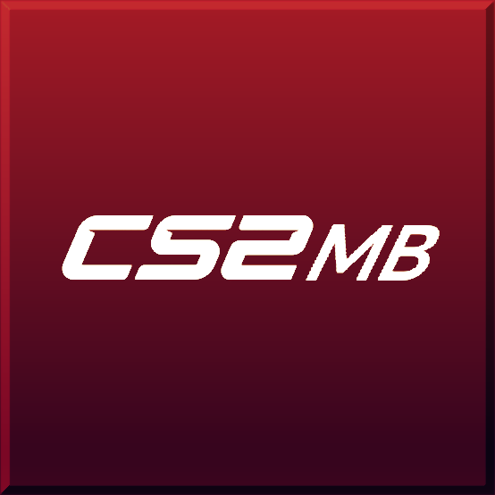
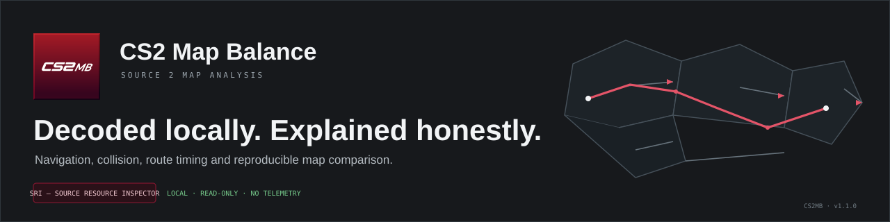
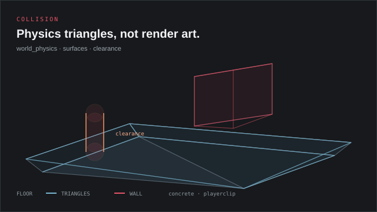
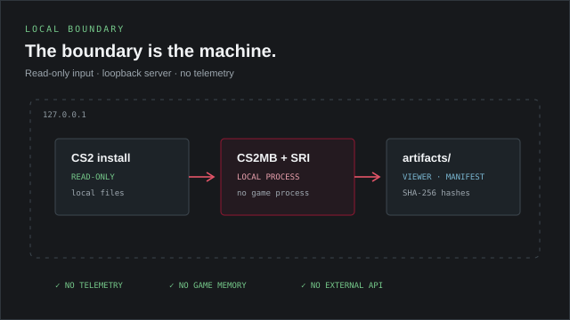
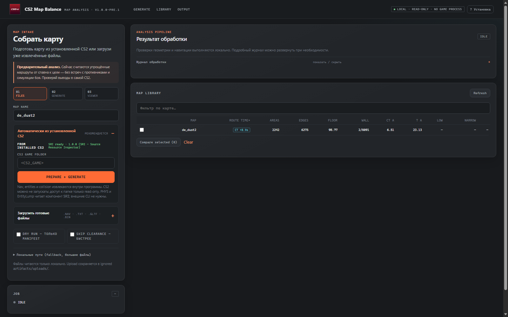
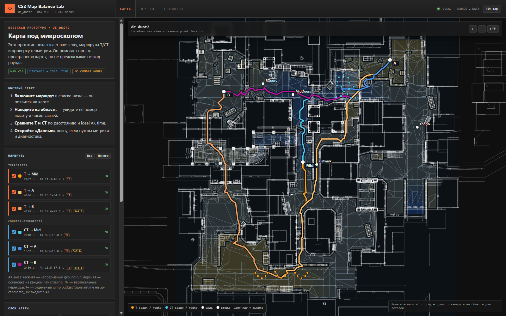
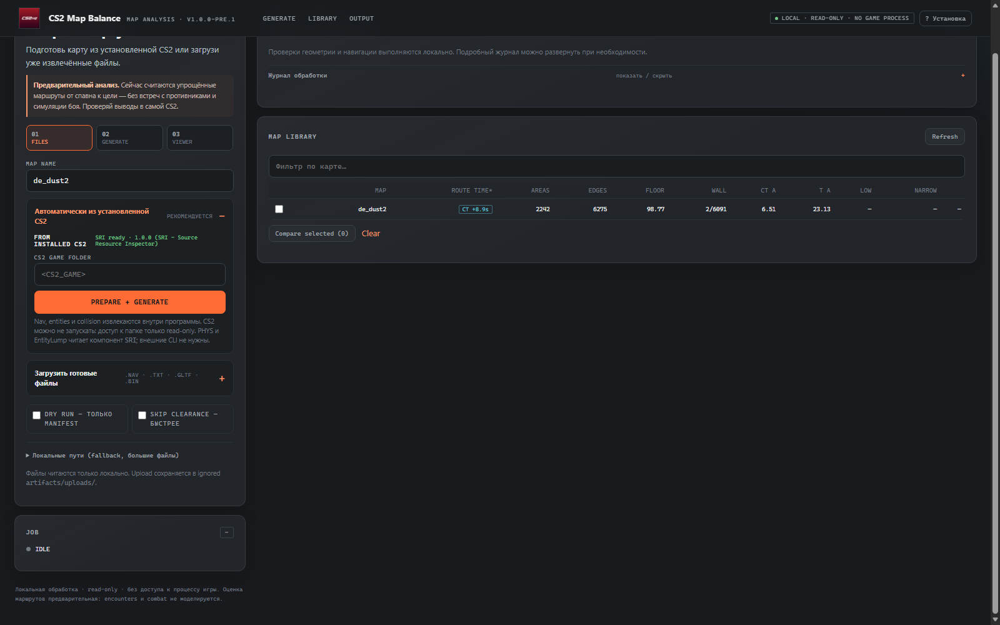
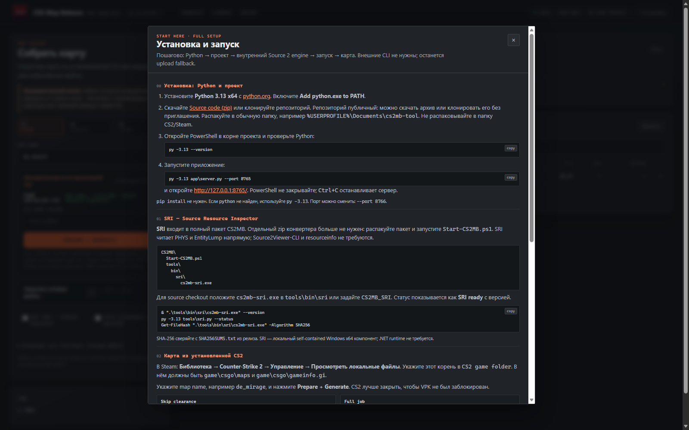

<p align="center">
  <b>English</b> · <a href="README.ru.md">Русский</a>
</p>

<p align="center">
  
</p>

<p align="center">
  
</p>

<h1 align="center">CS2 Map Balance</h1>

<p align="center">
  A local, read-only engineering tool for Counter-Strike 2 map geometry,
  navigation, collision, route timing and reproducible map comparison.
</p>

<p align="center">
  <a href="https://github.com/Shtoblam/cs2mb-tool/releases/tag/v1.0.0-pre.1"></a>
  
  <a href="https://github.com/Shtoblam/cs2mb-tool/actions/workflows/tests.yml"></a>
  
  
</p>

<p align="center">
  <a href="https://github.com/Shtoblam/cs2mb-tool/releases/tag/v1.0.0-pre.1"><strong>Complete Windows release ↗</strong></a> ·
  <a href="https://shtoblam.github.io/cs2mb-tool/"><strong>Project website ↗</strong></a> ·
  <a href="https://github.com/Shtoblam/cs2mb-tool">GitHub repository ↗</a> ·
  <a href="README.ru.md">Русская версия</a>
</p>

> [!WARNING]
> **The CT/T indicator is a preliminary route-time signal, not a competitive balance verdict.**
> It compares estimated travel time along navigation routes from spawns to common targets. It does
> **not** simulate enemy encounters, firefights, utility, line of sight, player decisions, rotations
> under pressure or round outcomes. A value such as `CT +8.9s` is a reason to investigate, not proof
> that a map is CT-sided or a prediction of win rate.

## About CS2MB

CS2 Map Balance turns read-only Counter-Strike 2 resources into validated,
inspectable data and uses that data for route, movement and comparison analysis.
It is intentionally **not** a map viewer, a shortest-path demo or a competitive
predictor.

The project separates seven layers that must not be treated as interchangeable:

| Layer | What the project uses |
|---|---|
| Visual | Render assets, optional reference only |
| Geometric | Coordinates, polygons and triangles |
| Collision | `world_physics` geometry, floors, walls, clearance |
| Navigation | Directed nav areas, connections, one-way links, components |
| Movement | Measured speeds and a calibrated straight-line model |
| Scenarios | Spawn-to-target rush and split time envelopes |
| Balance | A time-only comparison of route estimates |

Every result should be read with the layer that produced it in mind. See
[docs/PROJECT.md](docs/PROJECT.md) for definitions and
[docs/ARCHITECTURE.md](docs/ARCHITECTURE.md) for the full architecture.

## SRI — Source Resource Inspector

The internal Source 2 component is **SRI**. It is not a universal Source 2
viewer, editor or a renamed third-party CLI. It is the first-party resource
inspector and converter used by CS2MB for the two compiled resources that the
analysis pipeline needs.

<p align="center">
  
</p>

- `world_physics.vmdl_c` → PHYS → glTF + `.bin`
- `default_ents.vents_c` → EntityLump → entity text
- binary KV3, Zstandard and LZ4 decoding from the pinned MIT
  ValveResourceFormat library
- self-contained Windows x64 executable, included in the complete CS2MB package
- no .NET runtime, Source2Viewer-CLI or `resourceinfo.exe` required
- SRI path, version and SHA-256 recorded in the preparation manifest

## Navigation and collision are separate evidence

<p align="center">
  
  
</p>

- Navigation is directed where the source requires it; one-way links,
  disconnected components, ladders and vertical relationships are preserved.
- Collision comes from `world_physics`, not from render geometry.
- A route can be valid in NAV and blocked by collision; that is reported as a
  diagnostic, not ignored.
- Floor, wall and clearance checks use the existing collision loader and
  Hammer-unit/Source-axis contract.

## Local by design

<p align="center">
  
</p>

- the server binds `127.0.0.1` by default; remote binding is disabled;
- the game installation is opened read-only;
- no game process, memory access, injection, gameplay automation or VAC
  interaction;
- no telemetry, external uploads or runtime internet dependency;
- prepared inputs and outputs carry SHA-256 provenance.

## Current application

These are actual screenshots of the current `v1.0.0-pre.1` application.

<p align="center">
  
</p>

<p align="center">
  
</p>

<p align="center">
  
</p>

## Current capabilities

- Complete Windows x64 package with SRI and a bundled Python 3.13 runtime.
- Internal source-resource inspection for compiled entity and physics resources.
- Read-only VPK and NAV extraction from a local CS2 installation.
- Browser upload/drop of `.nav`, entity `.txt`, physics `.gltf` and `.bin`.
- Directed navigation graph with one-way links, components and z-aware lookup.
- Generated self-contained viewer with representative and all spawn-to-target
  routes.
- Collision floor, wall and clearance reports.
- `AK a-b s` route-time range, vertical-transition and `J+` jump-budget
  indicators.
- Local map library with a preliminary CT/T route-time indicator and
  side-by-side comparison.
- `manifest.json` with SHA-256 input, output and SRI hashes.
- Loopback-only server with upload limits, path allow-listing, Host and Origin
  checks, bounded concurrent jobs and process-tree timeouts.

## Pipeline

<p align="center">
  
</p>

```text
CS2 installation (read-only)
  map VPK
    ├─ <map>.nav              -> existing Python NAV parser
    ├─ default_ents.vents_c   -> SRI entities -> entity dump
    └─ world_physics.vmdl_c   -> SRI phys     -> glTF + .bin
                                     |
                                     v
                    existing NAV / collision / movement analysis
                                     |
                                     v
                    viewer + summary + SHA-256 manifest + library
```

The same pipeline is available from the local web app and from the command line
(`tools/auto_generate.py`, `tools/prepare_map.py`). Analysis reads prepared data;
it does not silently re-read game files. Visualization never changes analytical
results.

## Installation

Download the complete Windows x64 package from
**[the v1.0.0-pre.1 release](https://github.com/Shtoblam/cs2mb-tool/releases/tag/v1.0.0-pre.1)**:

```text
CS2MB-v1.0.0-pre.1-win-x64.zip
```

Extract it to a normal user folder and run:

```text
Start-CS2MB.bat
```

The package includes:

- the SRI executable at `tools/bin/sri/cs2mb-sri.exe`;
- a portable Python 3.13 runtime at `runtime/`;
- the local application, analysis modules, viewer generator and documentation.

No Python installation, `pip install`, .NET runtime, Source2Viewer-CLI or
`resourceinfo.exe` is required. CS2 remains optional for upload mode.

If you prefer the source checkout:

```powershell
git clone https://github.com/Shtoblam/cs2mb-tool.git
cd cs2mb-tool
py -3.13 tools\sri.py --status
py -3.13 app\server.py --port 8765
```

For full installation and troubleshooting, read
**[docs/SETUP.md](docs/SETUP.md)**. For manual file preparation, read
**[docs/GETTING_FILES.md](docs/GETTING_FILES.md)**.

<p align="center">
  
</p>

### Build SRI from source (optional)

Normal users do not need this. Building requires the .NET SDK 10.0.x; the
published SRI executable does not require the SDK or runtime.

```powershell
sri\build.ps1
```

The build is pinned by `sri/global.json`, the package version in
`sri/Cs2mb.Sri/Cs2mb.Sri.csproj` and `packages.lock.json`. See
[sri/README.md](sri/README.md) and
[sri/THIRD_PARTY_NOTICES.md](sri/THIRD_PARTY_NOTICES.md).

## Current validation

Reference environment: CS2 build `2000948` (2026-11-19), Windows x64,
Python 3.13.3, SRI `1.0.0`, ValveResourceFormat `20.1.7467`.

| Map | NAV areas | Collision primitives | Triangles | Floor agreement |
|---|---:|---:|---:|---:|
| de_dust2 | 2242 | 39 | 435,649 | 98.77% |
| de_mirage | 2544 | 41 | 133,133 | 99.06% |
| de_nuke | 3040 | 32 | 191,628 | 99.27% |
| de_inferno | 2739 | 52 | 2,733,610 | 99.54% |
| de_ancient | 1969 | 15 | 967,778 | 98.73% |
| de_train | 2154 | 40 | 1,574,220 | 99.39% |
| de_vertigo | 2105 | 37 | 210,596 | 99.45% |
| de_anubis | 2633 | 34 | 715,842 | 97.34% |
| de_overpass | 3938 | 36 | 884,775 | 97.71% |

Entity output was compared against a local `resourceinfo` reference for all nine
maps: identical entity counts, class distributions and origins (one Inferno
spawn differs by 0.01 units from text rounding). Dust2 reproduces the historical
collision totals exactly: 39 primitives, 1,306,947 exported vertices and
435,649 triangles.

The values are local integration evidence, not a claim that every future CS2
build is covered. See [docs/VALIDATION.md](docs/VALIDATION.md) for methodology
and [docs/STATE.md](docs/STATE.md) for the current evidence record.

## Important limitations

- Navigation is a bot abstraction, not exact player collision.
- Route distance is not travel time, and travel time is not match balance.
- The movement model covers straight-line ground motion only; turning, stairs,
  ramps, landing, ladders and air movement are not calibrated.
- Collision extraction follows the physics resource; it does not simulate
  dynamic doors, breakables or every gameplay entity.
- Sphere and capsule collision is tessellated for analysis, not an exact
  analytic surface.
- The route-time indicator has no confidence interval, encounter model or
  win-rate meaning.
- Full clearance was exercised on Dust2 and Nuke; other maps used
  `Skip clearance` in the recorded batch.

## Architecture

| Component | Responsibility |
|---|---|
| `tools/vpk_read.py` | read-only VPK listing and extraction |
| `tools/prepare_map.py` | map VPK intake and SRI orchestration |
| `tools/sri.py` | SRI resolution, argument arrays, timeouts, status |
| `sri/` | first-party PHYS and EntityLump inspector |
| `tools/nav_inspect.py` | NAV parsing and graph summary |
| `tools/gltf_collision.py` | collision loading, floor/wall/clearance queries |
| `movement/` | speed profile and route-time model |
| `simulation/` | rush/split time envelopes and balance comparison |
| `prototype/dust2_viewer.py` | self-contained viewer generation |
| `app/server.py` | local intake UI, uploads, jobs, library |

The Python analysis layer remains standard-library only. SRI is the only
packaged binary component and is isolated behind `tools/sri.py`.

## Security and privacy

The project is a **local file analyzer**. It does not launch CS2 or Steam, attach
to a game process, read or write game memory, inject code, automate gameplay,
contact game servers or anti-cheat, or send telemetry.

- Server binds `127.0.0.1`; remote binding is rejected.
- Host and Origin checks protect the local HTTP surface.
- Uploads are limited by count, size and extension; paths are normalized and allow-listed.
- Jobs have a concurrency limit, process-tree timeout and stale-record cleanup.
- The generated viewer is self-contained and served with a restrictive CSP.
- The intake UI sends a CSP response header and matching meta policy.
- SRI is a trusted local binary; its SHA-256 is recorded per preparation.
- Generated map data, uploads and extracted resources stay out of Git.

Read the full model in [docs/SECURITY.md](docs/SECURITY.md) (also available in
Russian: [docs/SECURITY.ru.md](docs/SECURITY.ru.md)). No tool can promise Valve's
future policy; these statements describe this code and its documented
dependencies.

## Documentation

The complete documentation index is **[docs/README.md](docs/README.md)**.

- [Setup and troubleshooting](docs/SETUP.md) · [Настройка](docs/SETUP.ru.md)
- [Getting map files](docs/GETTING_FILES.md) · [Получение файлов](docs/GETTING_FILES.ru.md)
- [SRI component](sri/README.md)
- [Architecture](docs/ARCHITECTURE.md)
- [Decisions](docs/DECISIONS.md)
- [Research](docs/RESEARCH.md)
- [Validation](docs/VALIDATION.md)
- [Security](docs/SECURITY.md) · [Безопасность](docs/SECURITY.ru.md)
- [Roadmap](docs/ROADMAP.md)
- [Current project state](docs/STATE.md)
- [Release notes](docs/RELEASE.md) and [release archive](docs/releases/)
- [Changelog](CHANGELOG.md)

## Development and testing

```powershell
py -3.13 -m unittest discover -s tests -v
py -3.13 tools\security_scan.py
py -3.13 -m compileall -q app tools movement simulation prototype
```

The current suite is **88 tests discovered / 87 executed / 1 real-map test
gated** by `CS2MB_TEST_GAME`. CI runs the Python suite, the SRI build and
SRI-backed tests on Windows. Tests are synthetic and unit-level: passing them is
not proof that geometry, collision, navigation or movement are correct in game.
See [docs/VALIDATION.md](docs/VALIDATION.md).

## Roadmap

- **v1.0.0-pre.1** — complete Windows package, SRI rename, security hardening,
  visual cleanup and consolidated release.
- **2.2** — line of sight, detection and encounter timing.
- **2.3** — encounter/combat model only after demo calibration.
- **3.0 research** — broader resource-format coverage and golden comparison
  across future CS2 builds.

Priorities and dependencies are maintained in [docs/ROADMAP.md](docs/ROADMAP.md).

## License and independence

MIT. See [LICENSE](LICENSE). The original `logo.png` is the canonical CS2MB
identity and is preserved unchanged. This project is not affiliated with Valve.
ValveResourceFormat is an MIT-licensed community library, not a Valve product or
an official CS2 SDK. Extracted game resources remain Valve property and must not
be committed or redistributed.
