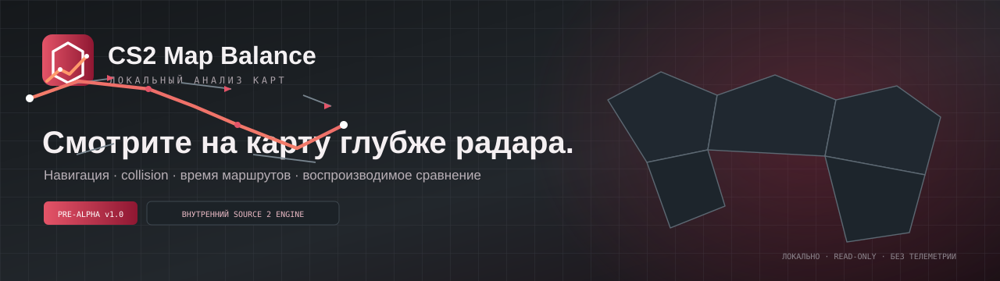
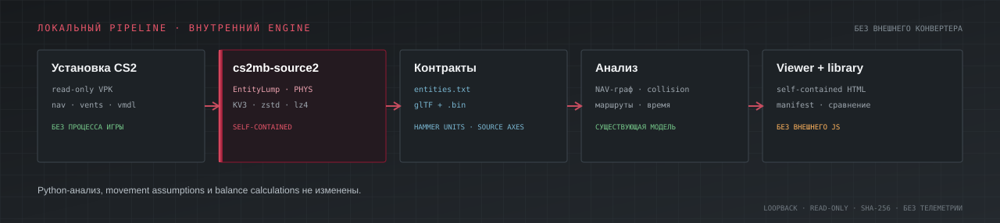
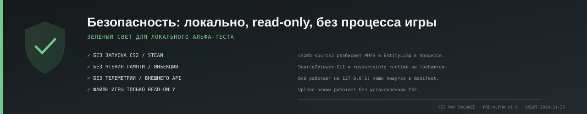

<p align="center">
  <a href="README.md">English</a> · <b>Русский</b>
</p>

<p align="center">
  
</p>

<h1 align="center">CS2 Map Balance</h1>

<p align="center">
  Локальный read-only исследовательский инструмент для анализа геометрии карт
  Counter-Strike 2, навигации, коллизий, времени маршрутов и воспроизводимого
  сравнения карт.
</p>

<p align="center">
  <a href="https://github.com/Shtoblam/cs2mb-tool/archive/refs/heads/main.zip"></a>
  
  <a href="https://github.com/Shtoblam/cs2mb-tool/actions/workflows/tests.yml"></a>
  
  <a href="docs/SECURITY.ru.md"></a>
</p>

<p align="center">
  <a href="https://github.com/Shtoblam/cs2mb-tool"><strong>GitHub-репозиторий ↗</strong></a> ·
  <a href="https://github.com/Shtoblam/cs2mb-tool/archive/refs/heads/main.zip">Последний source ZIP</a> ·
  <a href="README.md">English</a>
</p>

> [!WARNING]
> **Текущий индикатор CT/T — предварительный сигнал по времени маршрута, а не вердикт о соревновательном балансе.**
> Он сравнивает расчётное время перемещения по навигационным маршрутам от спавнов
> до общих целей. Модель **не** симулирует встречи с противниками, перестрелки,
> utility, видимость, решения игроков, ротации под давлением и исход раунда.
> Значение вроде `CT +8.9s` — повод для проверки, а не доказательство преимущества
> стороны и не прогноз win rate.

## Что это за проект

CS2 Map Balance превращает read-only ресурсы карт Counter-Strike 2 в
проверяемые данные и использует их для анализа маршрутов, движения и сравнения
карт.

Проект намеренно **не ограничивается** просмотрщиком карт, демонстрацией
кратчайшего пути или предиктором соревновательного баланса. Он разделяет семь
слоёв, которые нельзя подменять друг другом:

| Слой | Что использует проект |
|---|---|
| Визуальный | Render-ресурсы, только как необязательный ориентир |
| Геометрический | Координаты, полигоны и треугольники |
| Коллизия | `world_physics` glTF, полы, стены, зазоры |
| Навигация | Направленные nav-области, связи, one-way, компоненты |
| Движение | Измеренные скорости и откалиброванная straight-line модель |
| Сценарии | Time-only rush и split envelopes от спавнов к целям |
| Баланс | Сравнение оценок времени маршрутов, а не исходов матчей |

Любой результат нужно читать с учётом слоя, который его произвёл. Определения —
в [docs/PROJECT.md](docs/PROJECT.md), полная архитектура — в
[docs/ARCHITECTURE.md](docs/ARCHITECTURE.md).

## Что уже умеет

- Read-only извлечение VPK, NAV и entities из локальной установки CS2.
- Загрузка `.nav`, entity `.txt`, physics `.gltf` и `.bin` через браузер.
- Направленный навигационный граф с one-way связями, компонентами и z-aware поиском.
- Self-contained viewer с representative и всеми spawn-to-target маршрутами.
- Отчёты по полу, стенам и зазорам коллизий.
- Диапазон `AK a-b s`, индикаторы вертикальных переходов и `J+` jump budget.
- Локальная библиотека карт с предварительным индикатором CT/T и сравнением.
- `manifest.json` с SHA-256 хэшами входов и glTF sidecar.
- Локальный server только на loopback с лимитами загрузки, allow-list путей,
  проверкой origin и таймаутом jobs.

<p align="center">
  
</p>

## Как устроен pipeline

```text
Установка CS2 (только чтение)
  map VPK -> nav / entities / world_physics.vmdl_c
          -> resourceinfo.exe (дамп entities)
          -> Source2Viewer-CLI (physics glTF + .bin)
          -> локальная валидация (nav, пол, стены, зазоры)
          -> viewer + summary + SHA-256 manifest
          -> локальная библиотека карт / сравнение
```

Тот же pipeline доступен из локального веб-приложения и из командной строки
(`tools/auto_generate.py`, `tools/prepare_map.py`). Анализ работает с
подготовленными данными и не перечитывает файлы игры скрытно. Визуализация не
изменяет аналитические результаты.

## Состояние реализации

| Область | Статус |
|---|---|
| Map intake, NAV parser, entities, viewer, library | Реализовано и проверено на девяти картах |
| Диагностика пола/стен/зазоров коллизий | Реализована; часть аномалий ещё требует triage |
| Straight-line модель движения и диапазон времени | Реализована по одиночным замерам в игре; не откалибрована по demo ticks |
| Rush и split time envelopes | Реализованы как time-only сценарии; без blocking и встреч |
| Линия видимости, detection и encounter timing | Не реализовано (Release 2.2) |
| Combat, utility, экономика и прогноз win rate | Не реализовано; отложено осознанно |
| Полноценная 3D-визуализация | Не реализована; viewer использует 2.5D/SVG |
| Внутренние Entity/PHYS-парсеры | Research (Release 3.0); внешние инструменты остаются в основном пути |

Текущая версия приложения — [`pre-alpha v1.0`](VERSION). Это свежий baseline
репозитория `cs2mb-tool`; исторические release notes сохранены в
[docs/releases/](docs/releases/) как история проекта.

## Важные ограничения

- Nav — абстракция для ботов, а не точная коллизия игрока.
- Расстояние маршрута не равно времени, а время не равно балансу матча.
- Модель движения описывает только прямолинейное движение по полу; повороты,
  ступени, рампы, приземление, лестницы и воздух не откалиброваны.
- Collision export может не содержать часть static props, динамических дверей и
  breakables.
- У индикатора времени маршрута нет доверительного интервала, модели встреч или
  смысла win rate.
- Таблица девяти карт ниже — историческое свидетельство alpha-батча, а не свежая
  проверка всех ресурсов на текущей сборке игры.

## Быстрый старт

Требования: **Windows 10/11 x64**, **Python 3.13 x64**, шаг `pip install` не
нужен. CS2 нужна только для автоматического режима; Source2Viewer-CLI не нужен,
если у вас уже есть physics glTF + `.bin`.

```powershell
git clone https://github.com/Shtoblam/cs2mb-tool.git
cd cs2mb-tool
py -3.13 app\server.py --port 8765
```

Откройте <http://127.0.0.1:8765/>. Сервер должен оставаться на loopback.

Полная инструкция по установке, Source2Viewer-CLI и troubleshooting:
**[docs/SETUP.ru.md](docs/SETUP.ru.md)**. Ручное извлечение файлов карты:
**[docs/GETTING_FILES.ru.md](docs/GETTING_FILES.ru.md)**.

<p align="center">
  
</p>

## Проверенные карты

Значения записаны во время alpha-батча на CS2 build `25966348` (октябрь 2026).
Это историческое свидетельство, а не утверждение, что все ресурсы карт были
повторно проверены на текущей сборке.

| Карта | Areas | Edges | Floor | Wall flags | Routes | Route-time indicator* |
|---|---:|---:|---:|---:|---:|---|
| de_dust2 | 2242 | 6275 | 98.77% | 2/6091 | 90 | CT +8.9s |
| de_nuke | 3040 | 7676 | 99.27% | 0/7334 | 80 | CT +5.2s |
| de_train | 2154 | 5454 | 99.39% | 30/5229 | 56 | CT +10.5s |
| de_vertigo | 2105 | 5321 | 99.45% | 4/5131 | 60 | CT +7.0s |
| de_mirage | 2544 | 6381 | 99.06% | 4/6069 | 99 | CT +6.4s |
| de_inferno | 2738 | 7068 | 99.54% | 2/6922 | 120 | CT +8.0s |
| de_ancient | 1969 | 5085 | 98.73% | 0/5009 | 72 | CT +8.5s |
| de_anubis | 2633 | 6877 | 97.34% | 2/6750 | 96 | CT +7.3s |
| de_overpass | 3938 | 10016 | 97.71% | 0/9859 | 88 | CT +14.0s |

`*` Упрощённая оценка **только по времени маршрута** (median low) до общих
целей. Положительное значение CT означает лишь, что расчётный подход CT быстрее
при текущих допущениях. Это **не** доказательство преимущества стороны.

Полный clearance выполнялся на Dust2 и Nuke; остальные карты батча — `Skip
clearance`. Методика и аномалии: [docs/MAP_DATA.md](docs/MAP_DATA.md) и
[docs/VALIDATION.md](docs/VALIDATION.md).

## Безопасность и приватность

Проект — **локальный анализатор файлов**. Он не запускает CS2/Steam, не
подключается к процессу игры, не читает и не пишет память, не делает инъекции,
не автоматизирует геймплей, не обращается к игровым серверам или anti-cheat и не
отправляет телеметрию.

- Сервер по умолчанию слушает `127.0.0.1`; выход за loopback требует явного флага.
- Загрузки ограничены по количеству, размеру и расширениям; пути нормализуются и проверяются.
- POST-запросы проходят origin guard; у jobs есть таймаут.
- Сгенерированный viewer self-contained и отдаётся с ограничительным CSP.
- Intake UI отправляет CSP response header и соответствующую meta policy, а также защиту от framing и неверного MIME.
- Сгенерированные данные, uploads и извлечённые ресурсы не попадают в Git.

<p align="center">
  
</p>

Полная модель: [docs/SECURITY.ru.md](docs/SECURITY.ru.md) (English:
[docs/SECURITY.md](docs/SECURITY.md)). Ни один инструмент не может гарантировать
будущую политику Valve; утверждения относятся к этому коду и документированным
зависимостям.

## Документация

Полный индекс документации — **[docs/README.md](docs/README.md)**.

- [Установка и troubleshooting](docs/SETUP.ru.md) · [Setup](docs/SETUP.md)
- [Получение файлов](docs/GETTING_FILES.ru.md) · [Getting files](docs/GETTING_FILES.md)
- [Архитектура](docs/ARCHITECTURE.md) (русский)
- [Определения и ограничения проекта](docs/PROJECT.md) (русский)
- [Измерения движения](docs/MOVEMENT.md) (русский)
- [Методика валидации](docs/VALIDATION.md) (русский)
- [Безопасность](docs/SECURITY.ru.md) · [Security](docs/SECURITY.md)
- [Roadmap](docs/ROADMAP.md) (русский)
- [Текущее состояние](docs/STATE.md)
- [Release](docs/RELEASE.ru.md) и [архив релизов](docs/releases/)
- [Changelog](CHANGELOG.md)

> **Репозиторий и опубликованный сайт:** ссылки в этом README ведут на файлы
> GitHub-репозитория. Включённый static-site workflow по умолчанию не активирован;
> если он включён, публикуется только часть файлов, поэтому некоторые ссылки
> открываются на GitHub, но не в копии на Pages.

## Разработка и тесты

Runtime использует стандартную библиотеку Python. Шаг `pip install` не нужен.

```powershell
py -3.13 -m unittest discover -s tests -v
py -3.13 tools\security_scan.py
py -3.13 -m compileall -q app tools movement simulation prototype
```

Текущий набор содержит **56 unit tests** на этой ревизии репозитория. CI
запускает компиляцию, тесты и проверку гигиены репозитория на каждый push.
Pages workflow собирает статический
сайт только из website-файлов; для публикации требуется однократное включение
Pages владельцем репозитория. Тесты синтетические и unit-level: их прохождение
не доказывает корректность геометрии, коллизий, навигации или движения в игре.
См. [docs/VALIDATION.md](docs/VALIDATION.md).

## Roadmap

- **pre-alpha v1.0** — чистый baseline, auto-extraction, загрузка файлов, route-time indicator, сравнение.
- **2.2** — линия видимости, detection и encounter timing.
- **2.3** — encounter/combat модель только после demo-калибровки.
- **3.0 research** — внутренние Entity/PHYS-парсеры с golden-сравнением и fallback.

Приоритеты и зависимости: [docs/ROADMAP.md](docs/ROADMAP.md).

## Лицензия и независимость

MIT. См. [LICENSE](LICENSE). Проект не связан с Valve. Извлечённые ресурсы игры
остаются собственностью Valve и не должны коммититься или распространяться.
