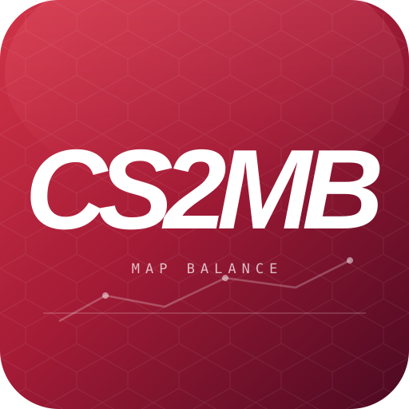
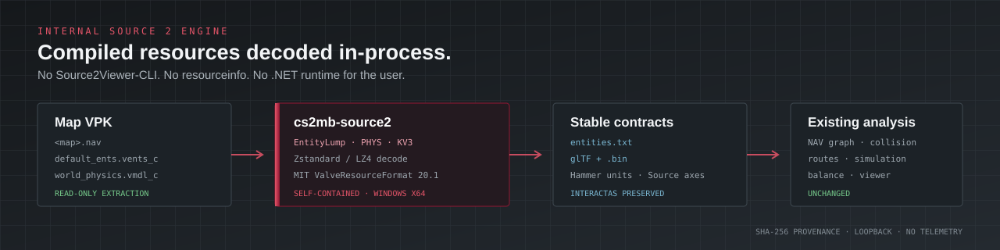
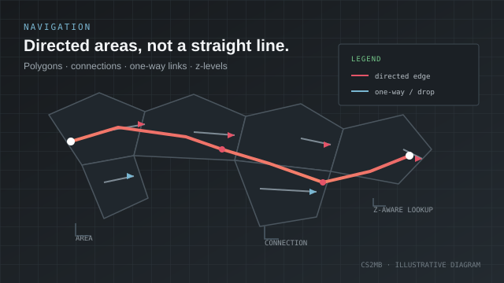
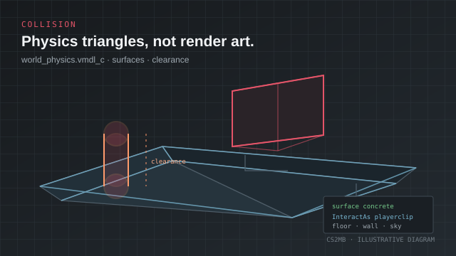
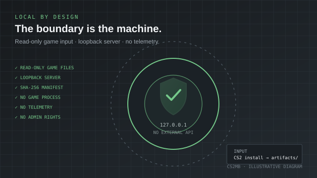

<p align="center">
  <a href="README.md">English</a> · <b>Русский</b>
</p>

<p align="center">
  
</p>

<p align="center">
  
</p>

<h1 align="center">CS2 Map Balance</h1>

<p align="center">
  Локальный read-only инженерный инструмент для геометрии карт Counter-Strike 2,
  навигации, collision, времени маршрутов и воспроизводимого сравнения карт.
</p>

<p align="center">
  <a href="https://github.com/Shtoblam/cs2mb-tool/archive/refs/heads/main.zip"></a>
  
  <a href="https://github.com/Shtoblam/cs2mb-tool/actions/workflows/tests.yml"></a>
  
  
</p>

<p align="center">
  <a href="https://shtoblam.github.io/cs2mb-tool/"><strong>Сайт проекта ↗</strong></a> ·
  <a href="https://github.com/Shtoblam/cs2mb-tool/releases/latest"><strong>Релиз engine ↗</strong></a> ·
  <a href="https://github.com/Shtoblam/cs2mb-tool">GitHub репозиторий ↗</a> ·
  <a href="README.md">English version</a>
</p>

> [!WARNING]
> **Индикатор CT/T — предварительный сигнал по времени маршрутов, а не вердикт о соревновательном балансе.**
> Он сравнивает оценку времени прохождения nav-маршрутов от спавнов до типовых целей. Он **не**
> моделирует встречи с противником, перестрелки, utility, видимость, решения игроков, ротации под
> давлением или исход раунда. Значение `CT +8.9s` — повод разобраться, а не доказательство
> CT-стороны карты и не прогноз win rate.

## О CS2MB

CS2 Map Balance превращает read-only ресурсы Counter-Strike 2 в проверяемые,
исследуемые данные и использует их для анализа маршрутов, движения и сравнения
карт. Это намеренно **не** просмотрщик карт, не демонстрация shortest path и не
предиктор соревновательного баланса.

Проект разделяет семь слоёв, которые нельзя считать взаимозаменяемыми:

| Слой | Что использует проект |
|---|---|
| Visual | Рендер-ассеты, только как необязательный reference |
| Geometric | Координаты, полигоны и треугольники |
| Collision | Геометрия `world_physics`, полы, стены, зазоры |
| Navigation | Направленные nav-области, связи, one-way, компоненты |
| Movement | Измеренные скорости и калиброванная straight-line модель |
| Scenarios | Временные конверты rush и split от спавнов до целей |
| Balance | Time-only сравнение оценок маршрутов |

Каждый результат нужно читать с учётом слоя, который его произвёл. Определения —
в [docs/PROJECT.md](docs/PROJECT.md), полная архитектура — в
[docs/ARCHITECTURE.md](docs/ARCHITECTURE.md).

## Чем проект отличается

### Source 2 ресурсы разбираются внутри

Автоматическому pipeline больше не нужны Source2Viewer-CLI или
`resourceinfo.exe`. Собственный компонент **cs2mb-source2** читает
скомпилированные PHYS и EntityLump напрямую и выдаёт существующие контракты
CS2MB.

<p align="center">
  
</p>

- `world_physics.vmdl_c` → PHYS → glTF + `.bin`
- `default_ents.vents_c` → EntityLump → entity text
- binary KV3, Zstandard и LZ4 из закреплённой MIT-библиотеки
  ValveResourceFormat
- self-contained Windows x64 компонент; .NET runtime пользователю не нужен
- путь, версия и SHA-256 engine записываются в preparation manifest

### Навигация и collision — разные доказательства

<p align="center">
  
  
</p>

- Навигация направленная там, где это требует источник; one-way связи,
  отсоединённые компоненты, лестницы и вертикальные отношения сохраняются.
- Collision берётся из `world_physics`, а не из render-геометрии.
- Маршрут может быть валиден в NAV и заблокирован collision; это
  диагностируется, а не игнорируется.
- Floor, wall и clearance проверки используют существующий collision loader и
  контракт Hammer units/Source axes.

### Локально по замыслу

<p align="center">
  
</p>

- сервер по умолчанию слушает `127.0.0.1`;
- установка игры открывается только для чтения;
- нет процесса игры, доступа к памяти, инъекций, автоматизации геймплея и
  взаимодействия с VAC;
- нет телеметрии, внешних загрузок и runtime-зависимости от интернета;
- подготовленные входы и выходы сопровождаются SHA-256 provenance.

## Текущие возможности

- Read-only извлечение VPK, NAV, EntityLump и PHYS из локальной CS2.
- Внутренний Source 2 engine для скомпилированных entity и physics ресурсов.
- Browser upload/drop `.nav`, entity `.txt`, physics `.gltf` и `.bin`.
- Направленный navigation graph с one-way, компонентами и z-aware lookup.
- Self-contained viewer с representative и all spawn-to-target маршрутами.
- Collision floor, wall и clearance отчёты.
- Диапазон `AK a-b s`, vertical-transition и `J+` jump-budget индикаторы.
- Локальная map library с предварительным CT/T route-time индикатором и
  сравнением карт.
- `manifest.json` с SHA-256 входов, выходов и engine.
- Loopback-only сервер с upload limits, allow-list путей, Origin checks и
  таймаутом job.

## Pipeline

<p align="center">
  
</p>

```text
Установка CS2 (read-only)
  map VPK
    ├─ <map>.nav              -> существующий Python NAV parser
    ├─ default_ents.vents_c   -> cs2mb-source2 entities -> entity dump
    └─ world_physics.vmdl_c   -> cs2mb-source2 phys     -> glTF + .bin
                                     |
                                     v
                    существующий NAV / collision / movement анализ
                                     |
                                     v
                    viewer + summary + SHA-256 manifest + library
```

Тот же pipeline доступен из локального веб-приложения и из командной строки
(`tools/auto_generate.py`, `tools/prepare_map.py`). Анализ читает подготовленные
данные и не перечитывает файлы игры скрыто. Визуализация не меняет
аналитические результаты.

## Установка

Требования: **Windows 10/11 x64**, **Python 3.13 x64** и ассет внутреннего
engine. `pip install`, .NET runtime, Source2Viewer-CLI и `resourceinfo.exe` не
нужны. CS2 необязательна для upload-режима.

```powershell
git clone https://github.com/Shtoblam/cs2mb-tool.git
cd cs2mb-tool

# Скачайте cs2mb-source2-win-x64.zip со страницы релизов и распакуйте:
# tools\bin\source2\cs2mb-source2.exe

py -3.13 tools\source2.py --status
py -3.13 app\server.py --port 8765
```

Откройте <http://127.0.0.1:8765/>. Сервер должен оставаться на loopback.

Полная установка и troubleshooting: **[docs/SETUP.ru.md](docs/SETUP.ru.md)**.
Ручная подготовка файлов: **[docs/GETTING_FILES.ru.md](docs/GETTING_FILES.ru.md)**.

<p align="center">
  
</p>

<p align="center"><sub>Реальный скриншот приложения: обучающий экран первого запуска.</sub></p>

### Сборка engine из исходников (необязательно)

Обычным пользователям это не нужно. Для сборки требуется .NET SDK 10.0.x.

```powershell
source2\build.ps1
source2\build.ps1 -Install
```

Версии закреплены в `source2/global.json`, `source2/Cs2mb.Source2/Cs2mb.Source2.csproj`
и `packages.lock.json`. См. [source2/README.md](source2/README.md) и
[source2/THIRD_PARTY_NOTICES.md](source2/THIRD_PARTY_NOTICES.md).

## Текущая валидация

Reference-окружение: CS2 build `2000948` (2026-11-19), Windows x64,
Python 3.13.3, `cs2mb-source2 1.0.0`, ValveResourceFormat `20.1.7467`.

| Карта | NAV areas | Collision primitives | Triangles | Floor agreement |
|---|---:|---:|---:|---:|
| de_dust2 | 2242 | 39 | 435,649 | 98.77% |
| de_mirage | 2544 | 41 | 133,133 | 99.06% |
| de_nuke | 3040 | 32 | 191,628 | 99.27% |
| de_inferno | 2739 | 52 | 2,733,610 | 99.54% |
| de_ancient | 1969 | 15 | 967,778 | 98.73% |
| de_train | 2154 | 40 | 1,574,220 | 99.39% |
| de_vertigo | 2105 | 37 | 210,596 | 99.45% |
| de_anubis | 2633 | 34 | 715,842 | 97.34% |
| de_overpass | 3938 | 36 | 884,775 | 97.71% |

Entity-вывод семантически совпадает с локальным `resourceinfo` reference для всех
девяти карт: одинаковые количества entity, распределения classname и origin
(один спавн Inferno отличается на 0.01 units из-за текстового округления).
Dust2 по-прежнему воспроизводит исторические collision-итоги точно: 39
primitives, 1,306,947 экспортированных vertices и 435,649 triangles.

Это локальные интеграционные доказательства, а не обещание покрытия любой
будущей сборки CS2. Методика — в [docs/VALIDATION.md](docs/VALIDATION.md),
текущее состояние доказательств — в [docs/STATE.md](docs/STATE.md).

## Важные ограничения

- Навигация — абстракция для ботов, а не точный player collision.
- Дистанция маршрута — не время, а время — не баланс матча.
- Movement-модель покрывает только straight-line ground motion; повороты,
  лестницы, рампы, landing, ladders и воздух не калиброваны.
- Collision следует physics-ресурсу; динамические двери, breakables и не все
  gameplay-entity моделируются.
- Sphere и capsule collision тесселируются для анализа, это не точная
  аналитическая поверхность.
- У route-time индикатора нет confidence interval, encounter-модели и смысла
  win rate.
- Полный clearance проверялся на Dust2 и Nuke; остальные карты в записанной
  серии использовали `Skip clearance`.

## Безопасность и приватность

Проект — **локальный анализатор файлов**. Он не запускает CS2/Steam, не
подключается к процессу игры, не читает и не пишет память, не внедряет код, не
автоматизирует геймплей, не связывается с игровыми серверами или anti-cheat и не
отправляет телеметрию.

- Сервер слушает `127.0.0.1`; non-loopback bind требует явного флага.
- Upload ограничен количеством, размером и расширениями; пути нормализуются и
  проходят allow-list.
- POST защищён Origin guard; job имеет timeout.
- Сгенерированный viewer self-contained и отдаётся с ограничительным CSP.
- Intake UI отдаёт CSP response header и соответствующую meta policy, а также
  framing/MIME protections.
- Engine — локальный доверенный бинарник; его SHA-256 записывается при
  подготовке.
- Сгенерированные данные карт, uploads и извлечённые ресурсы не попадают в Git.

<p align="center">
  
</p>

Полная модель — в [docs/SECURITY.ru.md](docs/SECURITY.ru.md) (English:
[docs/SECURITY.md](docs/SECURITY.md)). Ни один инструмент не может обещать
будущую политику Valve; утверждения относятся к этому коду и его документированным
зависимостям.

## Архитектура

| Компонент | Ответственность |
|---|---|
| `tools/vpk_read.py` | read-only VPK listing и extraction |
| `tools/prepare_map.py` | map VPK intake и orchestration engine |
| `tools/source2.py` | разрешение engine, argument arrays, timeouts, status |
| `source2/` | собственный PHYS и EntityLump converter |
| `tools/nav_inspect.py` | NAV parsing и graph summary |
| `tools/gltf_collision.py` | collision loading, floor/wall/clearance queries |
| `movement/` | speed profile и route-time model |
| `simulation/` | rush/split time envelopes и balance comparison |
| `prototype/dust2_viewer.py` | генерация self-contained viewer |
| `app/server.py` | локальный intake UI, uploads, jobs, library |

Python-анализ остаётся stdlib-only. Engine — единственный упакованный бинарный
компонент и изолирован через `tools/source2.py`.

## Документация

Полный индекс — **[docs/README.md](docs/README.md)**.

- [Установка](docs/SETUP.ru.md) · [Setup](docs/SETUP.md)
- [Получение файлов](docs/GETTING_FILES.ru.md) · [Getting files](docs/GETTING_FILES.md)
- [Внутренний engine](source2/README.md)
- [Архитектура](docs/ARCHITECTURE.md)
- [Решения](docs/DECISIONS.md)
- [Исследование](docs/RESEARCH.md)
- [Валидация](docs/VALIDATION.md)
- [Безопасность](docs/SECURITY.ru.md) · [Security](docs/SECURITY.md)
- [Roadmap](docs/ROADMAP.md)
- [Текущее состояние](docs/STATE.md)
- [Release notes](docs/RELEASE.ru.md) и [архив релизов](docs/releases/)
- [Changelog](CHANGELOG.md)

> **Репозиторий и опубликованный сайт:** ссылки в README ведут на файлы GitHub.
> Static-site workflow публикует только часть файлов, поэтому некоторые ссылки
> открываются на GitHub, но не на Pages.

## Разработка и тесты

```powershell
py -3.13 -m unittest discover -s tests -v
py -3.13 tools\security_scan.py
py -3.13 -m compileall -q app tools movement simulation prototype
```

Текущий набор: **76 tests discovered / 75 executed / 1 real-map test gated** через
`CS2MB_TEST_GAME`. CI запускает Python suite, сборку engine и engine-backed тесты
на Windows. Тесты синтетические и unit-level: их прохождение не доказывает
корректность геометрии, collision, навигации или движения в игре. См.
[docs/VALIDATION.md](docs/VALIDATION.md).

## Roadmap

- **pre-alpha v1.0** — чистый baseline репозитория, внутренний Source 2 engine,
  авто-извлечение карт, upload, route-time индикатор, сравнение.
- **2.2** — line of sight, detection и encounter timing.
- **2.3** — encounter/combat model только после demo-калибровки.
- **3.0 research** — более широкое покрытие форматов и golden-сравнение на
  будущих сборках CS2.

Приоритеты и зависимости — в [docs/ROADMAP.md](docs/ROADMAP.md).

## Лицензия и независимость

MIT. См. [LICENSE](LICENSE). Проект не связан с Valve. ValveResourceFormat —
MIT-библиотека сообщества, а не продукт Valve и не официальный CS2 SDK.
Извлечённые игровые ресурсы остаются собственностью Valve; их нельзя коммитить
или распространять.
