<p align="center">
  <a href="README.md">English</a> · <b>Русский</b>
</p>

<p align="center">
  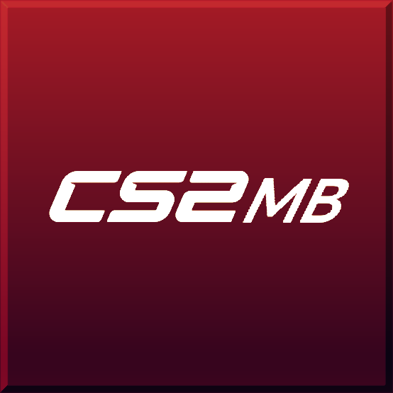
</p>

<p align="center">
  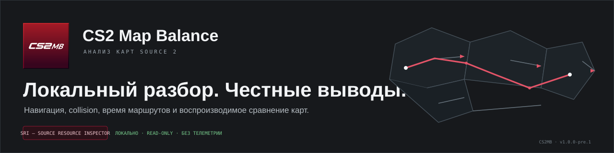
</p>

<h1 align="center">CS2 Map Balance</h1>

<p align="center">
  Локальный read-only инженерный инструмент для геометрии карт Counter-Strike 2,
  навигации, collision, времени маршрутов и воспроизводимого сравнения карт.
</p>

<p align="center">
  <a href="https://github.com/Shtoblam/cs2mb-tool/releases/tag/v1.1.1"></a>
  
  <a href="https://github.com/Shtoblam/cs2mb-tool/actions/workflows/tests.yml"></a>
  
  
</p>

<p align="center">
  <a href="https://github.com/Shtoblam/cs2mb-tool/releases/tag/v1.1.1"><strong>Полный Windows-релиз ↗</strong></a> ·
  <a href="https://shtoblam.github.io/cs2mb-tool/"><strong>Сайт проекта ↗</strong></a> ·
  <a href="https://github.com/Shtoblam/cs2mb-tool">GitHub репозиторий ↗</a> ·
  <a href="README.md">English version</a>
</p>

> [!WARNING]
> **Индикатор CT/T — предварительный сигнал по времени маршрутов, а не вердикт о соревновательном балансе.**
> Он сравнивает оценку времени прохождения nav-маршрутов от спавнов до типовых целей. Он **не**
> моделирует встречи с противником, перестрелки, utility, видимость, решения игроков, ротации под
> давлением или исход раунда. Значение `CT +8.9s` — повод разобраться, а не доказательство
> CT-стороны карты и не прогноз win rate.

## О CS2MB

CS2 Map Balance превращает read-only ресурсы Counter-Strike 2 в проверяемые,
исследуемые данные и использует их для анализа маршрутов, движения и сравнения
карт. Это намеренно **не** просмотрщик карт, не демонстрация shortest path и не
предиктор соревновательного баланса.

Проект разделяет семь слоёв, которые нельзя считать взаимозаменяемыми:

| Слой | Что использует проект |
|---|---|
| Visual | Рендер-ассеты, только как необязательный reference |
| Geometric | Координаты, полигоны и треугольники |
| Collision | Геометрия `world_physics`, полы, стены, зазоры |
| Navigation | Направленные nav-области, связи, one-way, компоненты |
| Movement | Измеренные скорости и калиброванная straight-line модель |
| Scenarios | Временные конверты rush и split от спавнов до целей |
| Balance | Time-only сравнение оценок маршрутов |

Каждый результат нужно читать с учётом слоя, который его произвёл. Определения —
в [docs/PROJECT.md](docs/PROJECT.md), полная архитектура — в
[docs/ARCHITECTURE.md](docs/ARCHITECTURE.md).

## SRI — Source Resource Inspector

Внутренний компонент Source 2 называется **SRI**. Это не универсальный
просмотрщик/редактор Source 2 и не переименованный сторонний CLI. Это собственный
инспектор и конвертер ресурсов, который CS2MB использует для двух
скомпилированных ресурсов, необходимых pipeline.

<p align="center">
  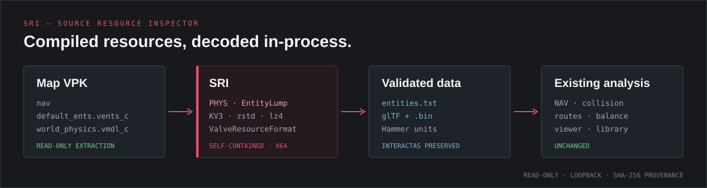
</p>

- `world_physics.vmdl_c` → PHYS → glTF + `.bin`
- `default_ents.vents_c` → EntityLump → entity text
- binary KV3, Zstandard и LZ4 из закреплённой MIT-библиотеки
  ValveResourceFormat
- self-contained Windows x64 executable входит в полный пакет CS2MB
- .NET runtime, Source2Viewer-CLI и `resourceinfo.exe` не требуются
- путь, версия и SHA-256 SRI записываются в preparation manifest

## 3DsVW — 3D Source Map Viewer

**3DsVW** — браузерный пространственный модуль. Он загружает сгенерированную
SRI collision-геометрию, NAV-полигоны, entity-маркеры и представительные
маршруты. Это viewer, а не экспорт render world: игровых материалов и текстур
нет.

<p align="center">
  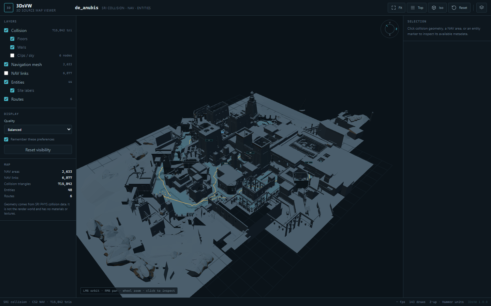
</p>

- three.js `0.160.0` упакован локально — без CDN и runtime-загрузок;
- полы, стены, прочие collision-поверхности и clip/sky разделены;
- NAV mesh, направленные связи, спавны CT/T, метки сайтов и маршруты —
  независимые слои;
- orbit, pan, zoom, fit, top, isometric и reset камеры;
- клик по геометрии, NAV или entity показывает только реально доступные
  метаданные;
- встроенный режим в приложении и отдельная вкладка;
- рендер по требованию и группировка геометрии для ограничения draw calls.

Viewer намеренно показывает **collision-геометрию**, а не выдуманную render-карту.
Управление и ограничения — в [docs/USER_GUIDE.ru.md](docs/USER_GUIDE.ru.md).

## Навигация и collision — разные доказательства

<p align="center">
  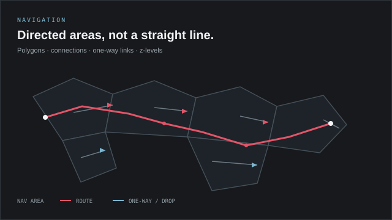
  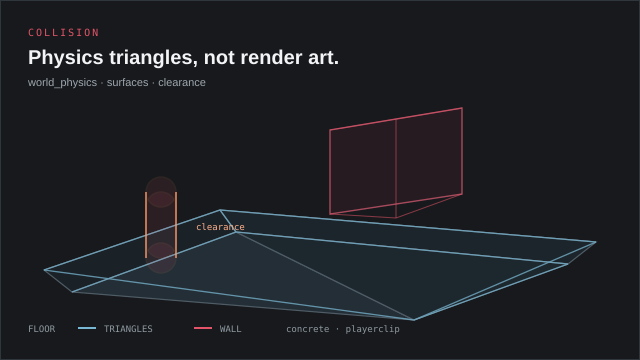
</p>

- Навигация направленная там, где это требует источник; one-way связи,
  отсоединённые компоненты, лестницы и вертикальные отношения сохраняются.
- Collision берётся из `world_physics`, а не из render-геометрии.
- Маршрут может быть валиден в NAV и заблокирован collision; это
  диагностируется, а не игнорируется.
- Floor, wall и clearance проверки используют существующий collision loader и
  контракт Hammer units/Source axes.

## Локально по замыслу

<p align="center">
  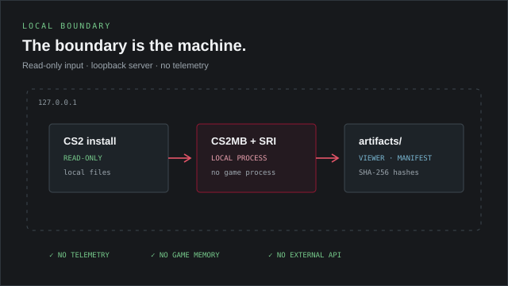
</p>

- сервер по умолчанию слушает `127.0.0.1`; remote binding отключён;
- установка игры открывается только для чтения;
- нет процесса игры, доступа к памяти, инъекций, автоматизации геймплея и
  взаимодействия с VAC;
- нет телеметрии, внешних загрузок и runtime-зависимости от интернета;
- подготовленные входы и выходы сопровождаются SHA-256 provenance.

## Текущее приложение

Это реальные скриншоты приложения `v1.1.1`.

<p align="center">
  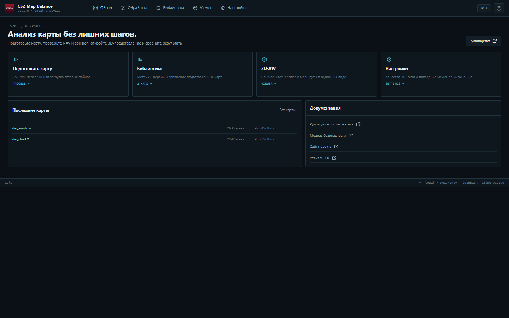
</p>

<p align="center">
  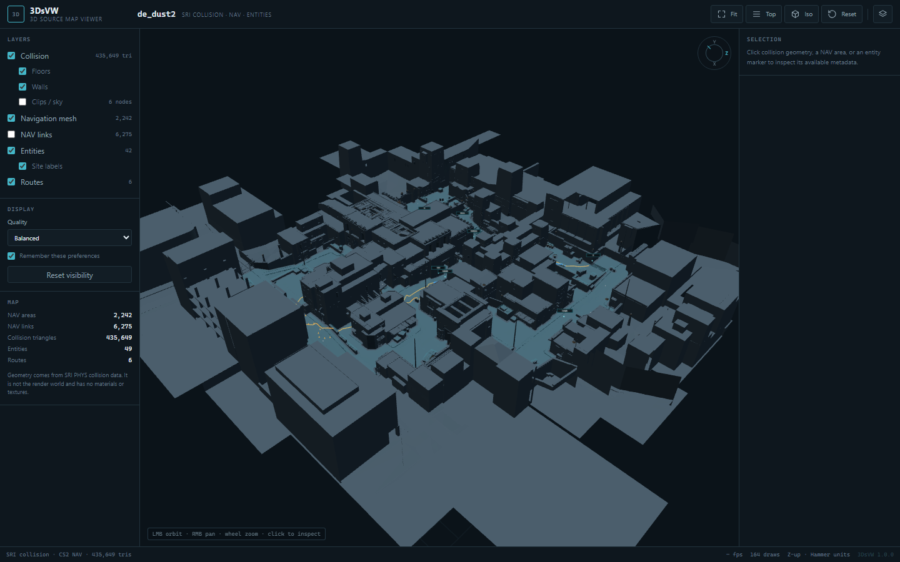
</p>

<p align="center">
  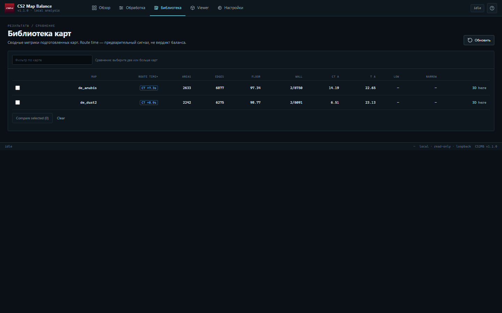
</p>

## Текущие возможности

- Полный Windows x64 пакет с SRI и встроенным Python 3.13 runtime.
- Внутренний разбор скомпилированных entity и physics ресурсов.
- Read-only извлечение VPK и NAV из локальной CS2.
- Browser upload/drop `.nav`, entity `.txt`, physics `.gltf` и `.bin`.
- Направленный navigation graph с one-way, компонентами и z-aware lookup.
- 3DsVW: встроенный/отдельный 3D-вид со слоями collision, NAV, entities и routes.
- Self-contained 2D viewer с representative и all spawn-to-target маршрутами.
- Collision floor, wall и clearance отчёты.
- Диапазон `AK a-b s`, vertical-transition и `J+` jump-budget индикаторы.
- Локальная map library с предварительным CT/T route-time индикатором и
  сравнением карт.
- `manifest.json` с SHA-256 входов, выходов и SRI.
- Loopback-only сервер с upload limits, allow-list путей, Host/Origin checks,
  ограничением параллельных jobs и process-tree timeout.

## Pipeline

<p align="center">
  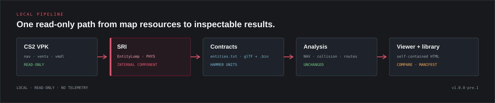
</p>

```text
Установка CS2 (read-only)
  map VPK
    ├─ <map>.nav              -> существующий Python NAV parser
    ├─ default_ents.vents_c   -> SRI entities -> entity dump
    └─ world_physics.vmdl_c   -> SRI phys     -> glTF + .bin
                                     |
                                     v
                    существующий NAV / collision / movement анализ
                                     |
                                     v
                    viewer + summary + SHA-256 manifest + library
```

Тот же pipeline доступен из локального веб-приложения и из командной строки
(`tools/auto_generate.py`, `tools/prepare_map.py`). Анализ читает подготовленные
данные и не перечитывает файлы игры скрыто. Визуализация не меняет
аналитические результаты.

## Установка

Скачайте полный пакет Windows x64 со
**[страницы релиза v1.1.1](https://github.com/Shtoblam/cs2mb-tool/releases/tag/v1.1.1)**:

```text
CS2MB-v1.1.1-win-x64.zip
```

Распакуйте в обычную пользовательскую папку и запустите:

```text
Start-CS2MB.bat
```

В пакет входят:

- SRI executable в `tools/bin/sri/cs2mb-sri.exe`;
- портативный Python 3.13 runtime в `runtime/`;
- локальное приложение, модули анализа, viewer и документация.

Установка Python, `pip install`, .NET runtime, Source2Viewer-CLI и
`resourceinfo.exe` не требуется. CS2 остаётся необязательной для upload-режима.

Source checkout:

```powershell
git clone https://github.com/Shtoblam/cs2mb-tool.git
cd cs2mb-tool
py -3.13 tools\sri.py --status
py -3.13 app\server.py --port 8765
```

Полная установка и troubleshooting: **[docs/SETUP.ru.md](docs/SETUP.ru.md)**.
Ручная подготовка файлов: **[docs/GETTING_FILES.ru.md](docs/GETTING_FILES.ru.md)**.

<p align="center">
  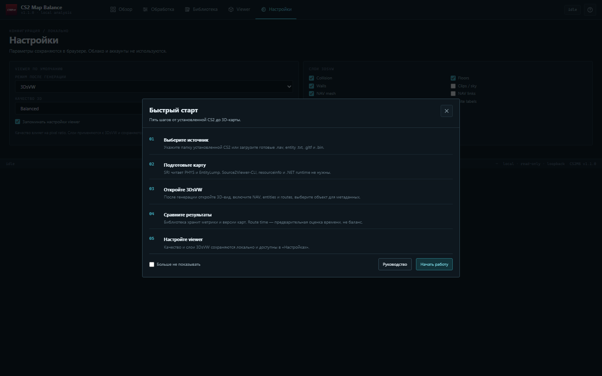
</p>

### Сборка SRI из исходников (необязательно)

Обычным пользователям это не нужно. Для сборки требуется .NET SDK 10.0.x;
опубликованный SRI executable не требует SDK или runtime.

```powershell
sri\build.ps1
```

Версии закреплены в `sri/global.json`, `sri/Cs2mb.Sri/Cs2mb.Sri.csproj` и
`packages.lock.json`. См. [sri/README.md](sri/README.md) и
[sri/THIRD_PARTY_NOTICES.md](sri/THIRD_PARTY_NOTICES.md).

## Текущая валидация

Reference-окружение: CS2 build `2000948` (2026-11-19), Windows x64,
Python 3.13.3, SRI `1.0.0`, ValveResourceFormat `20.1.7467`.

| Карта | NAV areas | Collision primitives | Triangles | Floor agreement |
|---|---:|---:|---:|---:|
| de_dust2 | 2242 | 39 | 435,649 | 98.77% |
| de_mirage | 2544 | 41 | 133,133 | 99.06% |
| de_nuke | 3040 | 32 | 191,628 | 99.27% |
| de_inferno | 2739 | 52 | 2,733,610 | 99.54% |
| de_ancient | 1969 | 15 | 967,778 | 98.73% |
| de_train | 2154 | 40 | 1,574,220 | 99.39% |
| de_vertigo | 2105 | 37 | 210,596 | 99.45% |
| de_anubis | 2633 | 34 | 715,842 | 97.34% |
| de_overpass | 3938 | 36 | 884,775 | 97.71% |

Интеграция 3DsVW проверена на de_dust2 и de_anubis: 435 649 / 715 842
collision-треугольников, 2 242 / 2 633 NAV areas и 164 / 141 draw calls в
локальном прогоне Edge. Это локальные наблюдения, не универсальный benchmark.

Entity-вывод сравнивался с локальным `resourceinfo` reference для всех девяти
карт: одинаковые количества entity, распределения classname и origin (один
спавн Inferno отличается на 0.01 units из-за текстового округления). Dust2
воспроизводит исторические collision-итоги точно: 39 primitives, 1,306,947
экспортированных vertices и 435,649 triangles.

Это локальные интеграционные доказательства, а не обещание покрытия любой
будущей сборки CS2. Методика — в [docs/VALIDATION.md](docs/VALIDATION.md),
текущее состояние — в [docs/STATE.md](docs/STATE.md).

## Важные ограничения

- Навигация — абстракция для ботов, а не точный player collision.
- Дистанция маршрута — не время, а время — не баланс матча.
- Movement-модель покрывает только straight-line ground motion; повороты,
  лестницы, рампы, landing, ladders и воздух не калиброваны.
- Collision следует physics-ресурсу; динамические двери, breakables и не все
  gameplay-entity моделируются.
- Sphere и capsule collision тесселируются для анализа, это не точная
  аналитическая поверхность.
- У route-time индикатора нет confidence interval, encounter-модели и смысла
  win rate.
- Полный clearance проверялся на Dust2 и Nuke; остальные карты в записанной
  серии использовали `Skip clearance`.

## Архитектура

| Компонент | Ответственность |
|---|---|
| `tools/vpk_read.py` | read-only VPK listing и extraction |
| `tools/prepare_map.py` | map VPK intake и orchestration SRI |
| `tools/sri.py` | разрешение SRI, argument arrays, timeouts, status |
| `sri/` | собственный PHYS и EntityLump inspector |
| `tools/nav_inspect.py` | NAV parsing и graph summary |
| `tools/gltf_collision.py` | collision loading, floor/wall/clearance queries |
| `movement/` | speed profile и route-time model |
| `simulation/` | rush/split time envelopes и balance comparison |
| `prototype/dust2_viewer.py` | генерация self-contained 2D viewer |
| `viewer3d/build.py` | 3DsVW bundle, экспорт NAV/entities/routes и нормализация glTF |
| `viewer3d/assets/` | локально упакованный three.js и 3DsVW viewer |
| `app/server.py` | локальный intake UI, uploads, jobs, library, confined viewer routes |

Python-анализ остаётся stdlib-only. SRI — единственный упакованный бинарный
компонент и изолирован через `tools/sri.py`.

## Безопасность и приватность

Проект — **локальный анализатор файлов**. Он не запускает CS2/Steam, не
подключается к процессу игры, не читает и не пишет память, не внедряет код, не
автоматизирует геймплей, не связывается с игровыми серверами или anti-cheat и не
отправляет телеметрию.

- Сервер слушает `127.0.0.1`; remote binding отклоняется.
- Host и Origin checks защищают локальный HTTP surface.
- Upload ограничен количеством, размером и расширениями; пути нормализуются и
  проходят allow-list.
- Jobs имеют лимит параллельности, process-tree timeout и очистку старых записей.
- Сгенерированный viewer self-contained и отдаётся с ограничительным CSP.
- Intake UI отдаёт CSP response header и соответствующую meta policy.
- SRI — локальный доверенный бинарник; его SHA-256 записывается при подготовке.
- Сгенерированные данные карт, uploads и извлечённые ресурсы не попадают в Git.

Полная модель — в [docs/SECURITY.ru.md](docs/SECURITY.ru.md) (English:
[docs/SECURITY.md](docs/SECURITY.md)). Ни один инструмент не может обещать
будущую политику Valve; утверждения относятся к этому коду и его
документированным зависимостям.

## Документация

Полный индекс — **[docs/README.md](docs/README.md)**.

- [Установка](docs/SETUP.ru.md) · [Setup](docs/SETUP.md)
- [Получение файлов](docs/GETTING_FILES.ru.md) · [Getting files](docs/GETTING_FILES.md)
- [SRI component](sri/README.md)
- [Руководство пользователя](docs/USER_GUIDE.ru.md) · [User guide](docs/USER_GUIDE.md)
- [Архитектура](docs/ARCHITECTURE.md)
- [Решения](docs/DECISIONS.md)
- [Исследование](docs/RESEARCH.md)
- [Валидация](docs/VALIDATION.md)
- [Безопасность](docs/SECURITY.ru.md) · [Security](docs/SECURITY.md)
- [Roadmap](docs/ROADMAP.md)
- [Текущее состояние](docs/STATE.md)
- [Release notes](docs/RELEASE.ru.md) и [архив релизов](docs/releases/)
- [Changelog](CHANGELOG.md)

## Разработка и тесты

```powershell
py -3.13 -m unittest discover -s tests -v
py -3.13 tools\security_scan.py
py -3.13 -m compileall -q app tools movement simulation prototype
```

Текущий набор: **128 tests discovered / 127 executed / 1 real-map test gated** через
`CS2MB_TEST_GAME`. CI запускает Python suite, сборку SRI и SRI-backed тесты на
Windows. Тесты синтетические и unit-level: их прохождение не доказывает
корректность геометрии, collision, навигации или движения в игре. См.
[docs/VALIDATION.md](docs/VALIDATION.md).

## Roadmap

- **v1.1.1** — patch-релиз: корректность pipeline и 3DsVW, санитизация
  путей, source-generated JSON в SRI и обслуживание CI.
- **v1.1.0** — редизайн UI, настройки, 3DsVW, focused security и performance
  review, руководства и полный Windows-пакет.
- **2.2** — line of sight, detection и encounter timing.
- **2.3** — encounter/combat model только после demo-калибровки.
- **3.0 research** — более широкое покрытие форматов и golden-сравнение на
  будущих сборках CS2.

Приоритеты и зависимости — в [docs/ROADMAP.md](docs/ROADMAP.md).

## Лицензия и независимость

MIT. См. [LICENSE](LICENSE). Оригинальный `logo.png` — каноническая айдентика
CS2MB и сохраняется без изменений. Проект не связан с Valve. ValveResourceFormat —
MIT-библиотека сообщества, а не продукт Valve и не официальный CS2 SDK.
Извлечённые игровые ресурсы остаются собственностью Valve; их нельзя коммитить
или распространять.
