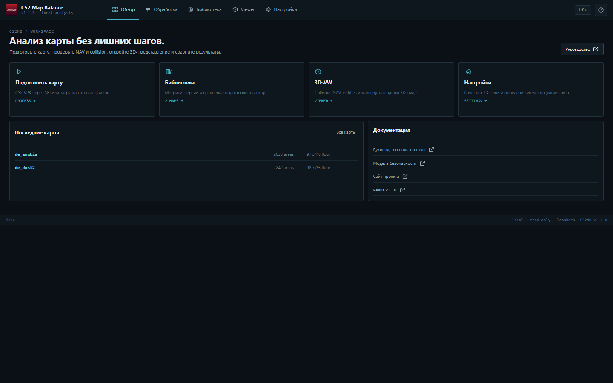
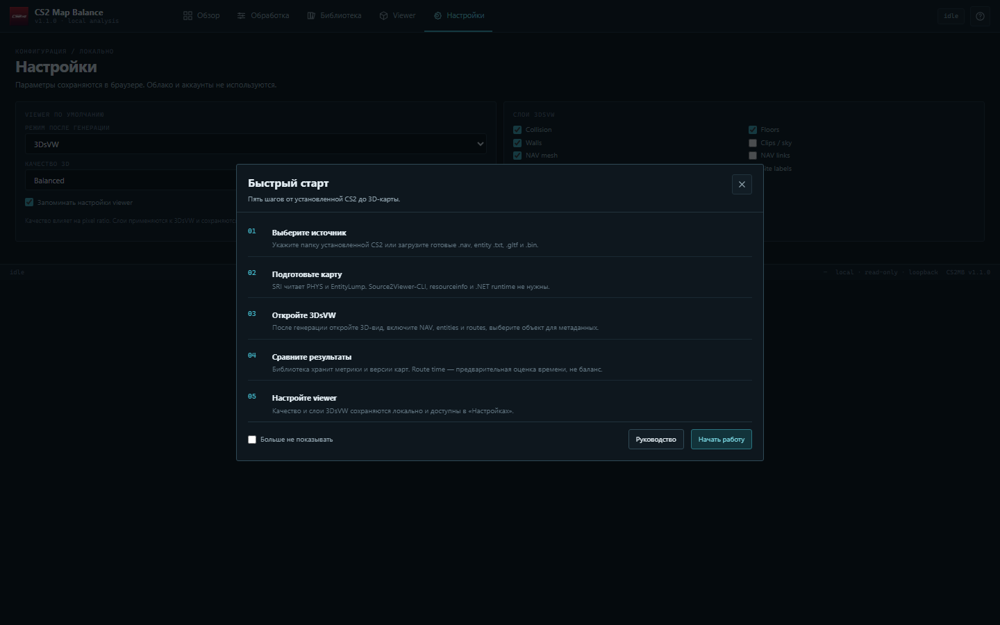
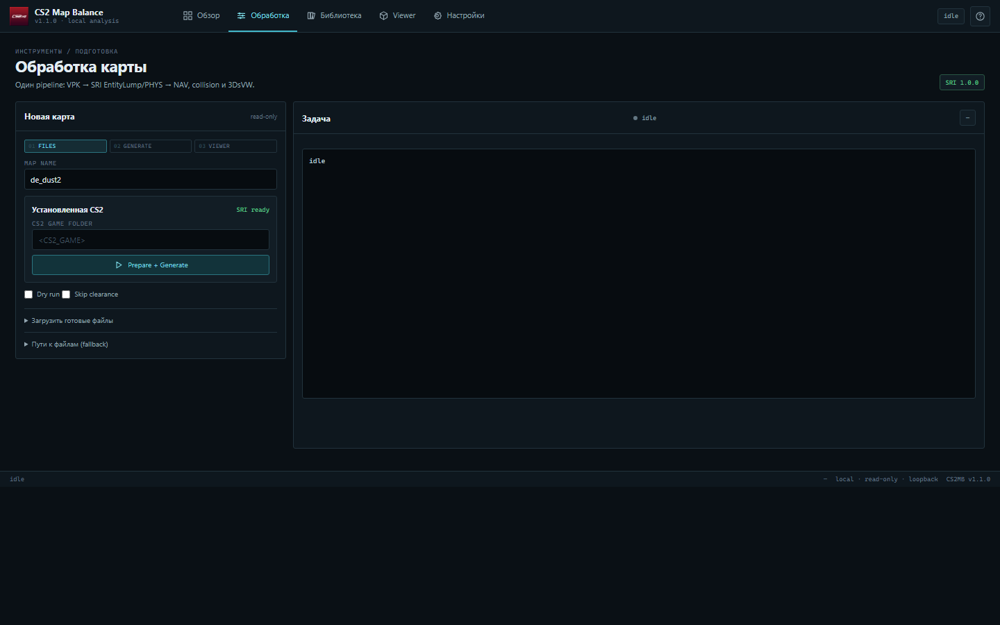
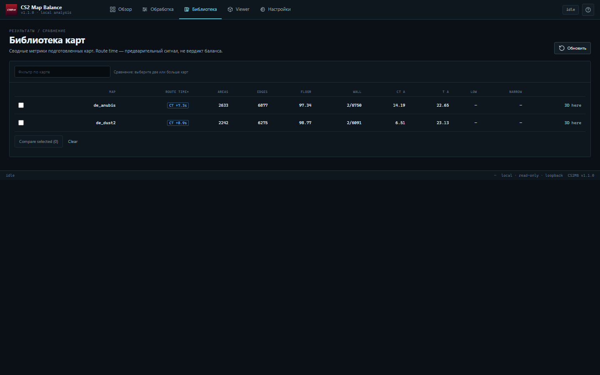
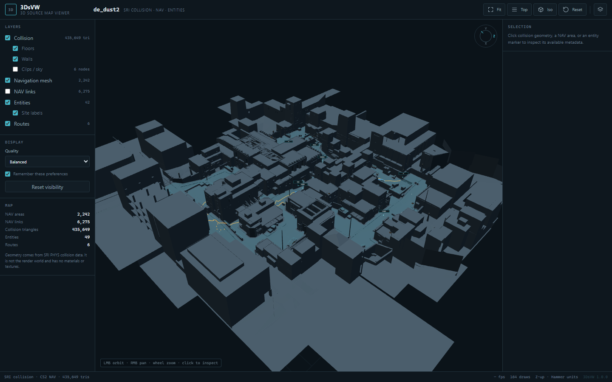
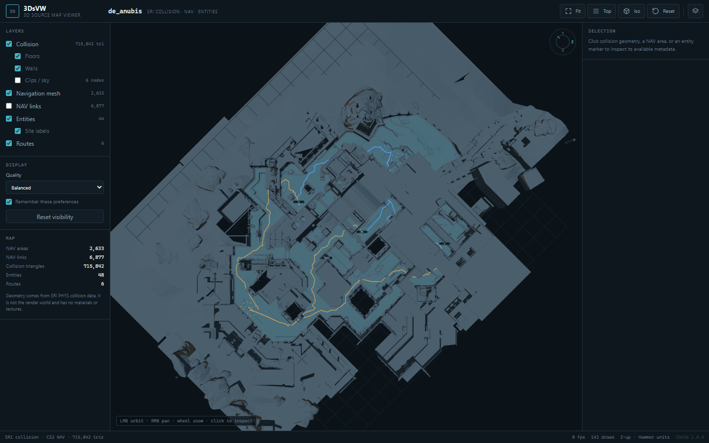
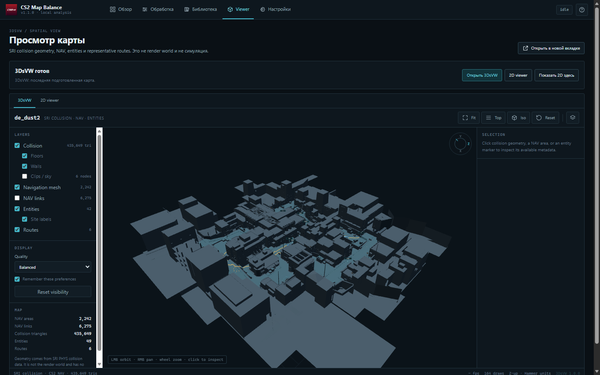
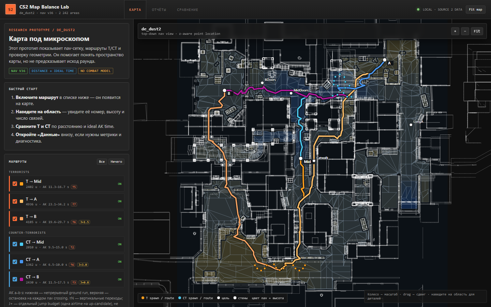
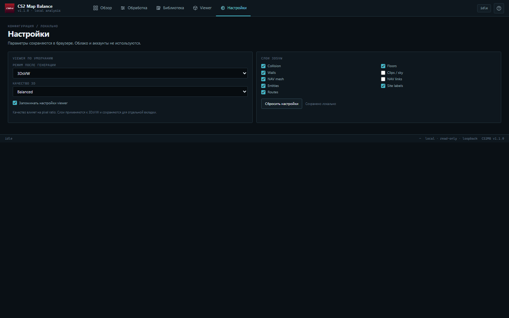

# CS2 Map Balance — User Guide

**Version:** `v1.1.1`
**Platform:** Windows 10/11 x64 (complete package)
**Scope:** local, read-only map analysis and 3D visualization

## 1. What CS2MB is

CS2 Map Balance turns prepared Counter-Strike 2 map data into inspectable
navigation, collision, route and comparison results. It is not a game server
tool, a map editor or a balance predictor. It never writes to the CS2/Steam
installation, launches the game or interacts with anti-cheat.

CS2MB has three distinct parts:

| Part | Role |
|---|---|
| **CS2MB** | Main application: intake, pipeline, library, comparison, settings |
| **SRI** | Source Resource Inspector: decodes compiled PHYS and EntityLump resources |
| **3DsVW** | 3D Source Map Viewer: browser-based spatial view of generated data |

The existing **2D viewer** is still available for route tables and the generated
SVG map. 3DsVW is an additional view; it does not replace the 2D viewer.

## 2. Requirements

- Windows 10/11 x64.
- The complete package `CS2MB-v1.1.1-win-x64.zip`.
- A local CS2 installation only for automatic extraction. Upload mode works
  without CS2.
- A browser with WebGL2 for 3DsVW: current Chrome, Edge or Firefox.
- No Python installation, `pip install`, .NET runtime, Source2Viewer-CLI or
  `resourceinfo.exe` is required for the packaged build.

## 3. Install and start

1. Download the complete package from the
   [v1.1.1 release](https://github.com/Shtoblam/cs2mb-tool/releases/tag/v1.1.1).
2. Verify the archive against `SHA256SUMS.txt`.
3. Extract it to a normal user folder, for example
   `%USERPROFILE%\Documents\CS2MB`.
4. Run `Start-CS2MB.bat` (or `Start-CS2MB.ps1`).
5. The local application opens at <http://127.0.0.1:8765/>.

The server binds loopback only. Remote binding is intentionally rejected.

## 4. Application layout





- **Обзор** — workspace summary and recent maps.
- **Обработка** — prepare a map from installed CS2 or uploaded files.
- **Библиотека** — generated map metrics, versions and comparison.
- **Viewer** — embedded 2D and 3DsVW views.
- **Настройки** — viewer mode, 3D quality and default layers.
- **Справка** — short tutorial; full guide is this document.

## 5. Prepare a map



### 5.1 From installed CS2 (recommended)

1. Open **Обработка**.
2. Enter the map name, for example `de_mirage`.
3. Set **CS2 game folder** to the CS2 installation root, not the `maps` folder.
4. Click **Prepare + Generate**.

The folder must contain:

```text
game\csgo\maps\<map>.vpk
game\csgo\gameinfo.gi
```

Close CS2 first if the VPK is locked. The pipeline reads the VPK, extracts NAV,
EntityLump and `world_physics.vmdl_c`, and calls SRI for the compiled resources.
Generated files go to `artifacts/`, never into the game folder.

### 5.2 Upload prepared files

1. Open **Обработка**.
2. Expand **Загрузить готовые файлы**.
3. Drag `.nav`, entity `.txt`, collision `.gltf` and `.bin` into the drop zone.
4. Click **Generate map**.

Allowed suffixes are `.nav`, `.txt`, `.gltf`, `.bin`. The upload limit is 300 MB
total, 12 files and 160 MB per file.

### 5.3 Fallback paths

Use **Пути к файлам (fallback)** for files already under `inputs/` or
`artifacts/uploads/`. The path API is restricted to these roots.

## 6. What SRI extracts

SRI is a first-party component shipped at
`tools/bin/sri/cs2mb-sri.exe`.

- `world_physics.vmdl_c` → PHYS → glTF + `.bin` collision geometry.
- `default_ents.vents_c` → EntityLump → entity text.
- Coordinates remain in Hammer units and Source axes (`x`, `y`, `z-up`).
- `InteractAs`, `SurfaceProperty` and `CollisionGroup` are preserved.
- Mesh and convex-hull geometry is exact; sphere/capsule primitives use bounded
  tessellation.
- SRI path, version and SHA-256 are recorded in the preparation manifest.

SRI is not a universal Source 2 viewer or editor. It does not provide render
world geometry, materials or textures.

Verify the packaged component:

```powershell
& ".\tools\bin\sri\cs2mb-sri.exe" --version
py -3.13 tools\sri.py --status
Get-FileHash ".\tools\bin\sri\cs2mb-sri.exe" -Algorithm SHA256
```

Expected: `cs2mb-sri 1.0.0 (SRI - Source Resource Inspector)`.

## 7. Results and manifest

A successful job writes to `artifacts/auto/<map>/<job>/`:

- `viewer.html` — self-contained 2D route viewer.
- `viewer3d/data.json` — NAV, entities, routes and collision metadata.
- `viewer3d/scene.gltf` + `scene.bin` — normalized collision geometry.
- `summary.json` — NAV, collision, route and balance summary.
- `manifest.json` — pipeline command and output provenance.
- `collision_floor.json`, `connection_check.json`, optional `clearance.json`.

The manifest contains input/output SHA-256 hashes. Personal absolute paths in
the preparation manifest are replaced by `<CS2_GAME>` and `prepared/...`.

## 8. Map library and comparison



The library shows the latest generated version per map:

- NAV areas and directed links.
- Floor agreement percentage.
- Wall checks.
- CT/T route-time indicator.
- Clearance flags where available.

Select two or more rows and click **Compare selected**. The comparison table is
a route-time and geometry summary, not a competitive verdict.

## 9. 3DsVW — 3D Source Map Viewer







3DsVW is a read-only WebGL2 viewer built with a locally bundled three.js. It
loads the generated collision glTF, NAV polygons and filtered entity markers.

### Open it

- From **Viewer** after a job finishes.
- From a library row: `3D` opens a separate tab; `here` opens it embedded.
- The **3DsVW** tab inside the application uses the same implementation.

### What is shown

- **Collision geometry** derived from SRI PHYS data, split into floors, walls and
  other surfaces by face orientation.
- **Clips / sky** volumes, hidden by default.
- **NAV mesh** as translucent polygons and optional directed-link lines.
- **Entities**: CT/T spawn markers, site labels and selected map objects.
- **Routes**: representative CT/T routes to A, B and Mid.

It is **not** render-world geometry and has no materials or textures. The map
shape is a truthful visualization of available collision data, not a screenshot
of the game.

### Camera

- Left mouse: orbit.
- Right mouse: pan.
- Wheel: zoom.
- **Fit** (`F`): fit the playable map.
- **Top** (`T`): top-down view.
- **Iso** (`I`): isometric view.
- **Reset** (`R`): fit and reset camera.
- **New tab** opens the same map separately.

### Layers and inspection

The left panel toggles collision, floors, walls, clips/sky, NAV mesh, NAV links,
entities, site labels and routes. **Reset visibility** restores defaults.

Click collision geometry, a NAV polygon or an entity marker to inspect available
metadata. The inspector shows only data that is actually present; it does not
invent names, surfaces or properties.

### Performance

3DsVW renders on demand, uses frustum culling and groups collision geometry into
a small number of draw calls. Measured locally:

| Map | Collision triangles | NAV areas | Draw calls |
|---|---:|---:|---:|
| de_dust2 | 435,649 | 2,242 | 164 |
| de_anubis | 715,842 | 2,633 | 141 |

These are local measurements in Edge on the reference desktop, not universal
benchmarks. Large maps may take longer to parse; the status bar shows draw calls.
Use the **Performance** quality preset on lower-end GPUs.

## 10. 2D viewer



The existing viewer remains available from **Viewer**. It contains NAV polygons,
representative and all spawn-to-target routes, route tables, collision checks and
diagnostics. It is self-contained HTML and works offline.

The 3DsVW tab and 2D tab are two views of the same generated map data.

## 11. Settings



Settings are stored in browser `localStorage`; no account or cloud service is
used.

- **Viewer mode** — choose 3DsVW or 2D after generation.
- **3D quality** — Performance (pixel ratio 1), Balanced (up to 1.5), Quality
  (up to 2).
- **Default layers** — collision, floors, walls, clips, NAV, NAV links, entities,
  site labels, routes.
- **Remember settings** — when off, viewer preferences are session-only.
- **Reset settings** — restore defaults.

The same layer and quality settings are applied to embedded and separate-tab
viewers.

## 12. Troubleshooting

| Symptom | Action |
|---|---|
| `SRI not installed` | Use the complete package; verify `tools\bin\sri\cs2mb-sri.exe`. |
| `SRI failed` | Check `artifacts/.../prepared/sri.log`; confirm the CS2 build is supported. |
| `invalid CS2 folder` | Select the CS2 root containing `game\csgo\maps`. |
| `too many active jobs` | Wait for a running job; the limit is two. |
| `missing Origin header` | Use the local web UI; direct non-browser POSTs are rejected. |
| 3D view says WebGL2 is required | Use a current Chrome, Edge or Firefox with hardware acceleration. |
| 3D view is empty | Confirm `viewer3d/data.json` and `scene.gltf` exist for the job; check the browser console and server log. |
| `no .bin` | Upload/export `.gltf` and `.bin` together. |
| Port busy | Start with `--port 8766`. |

## 13. Data, privacy and security

- The game installation is read-only.
- No telemetry, external uploads or runtime CDN is used by the viewer.
- The local server is loopback-only with Host and Origin checks.
- Uploads are bounded and extension-filtered; rejected uploads are removed.
- Generated viewer data is served from confined paths under the job directory.
- 3DsVW treats generated metadata as untrusted text and does not inject it as
  HTML.
- SRI is a local trusted binary; verify its SHA-256. It is not code-signed.
- Extracted game resources remain Valve property and must not be redistributed.

See [SECURITY.md](SECURITY.md) for the current security model and residual risks.

## 14. Limitations

- SRI and the package are Windows x64 only.
- 3DsVW visualizes collision-derived geometry, not the render world.
- Curved collision primitives are tessellated approximations.
- NAV is a bot abstraction, not exact player collision.
- Route time is an estimate, not measured gameplay time or match balance.
- The movement model covers straight-line ground motion; it does not model
  combat, utility, visibility, ladders or player decisions.
- Format support is tied to the recorded CS2 build; future Valve changes may
  require an SRI update.
- 3DsVW has no box selection, measurement tools or editing. It is a viewer.
