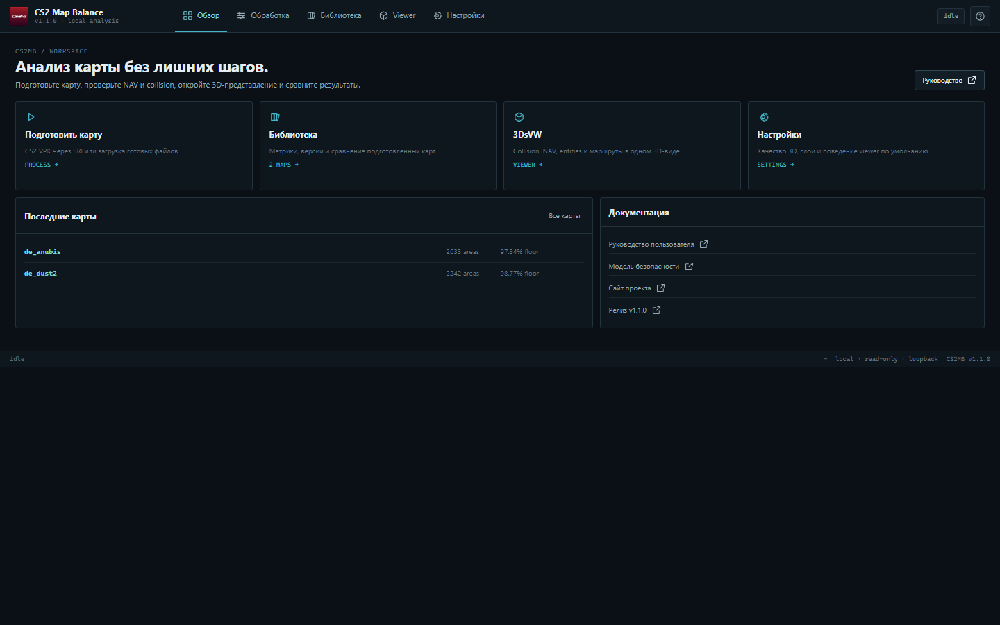
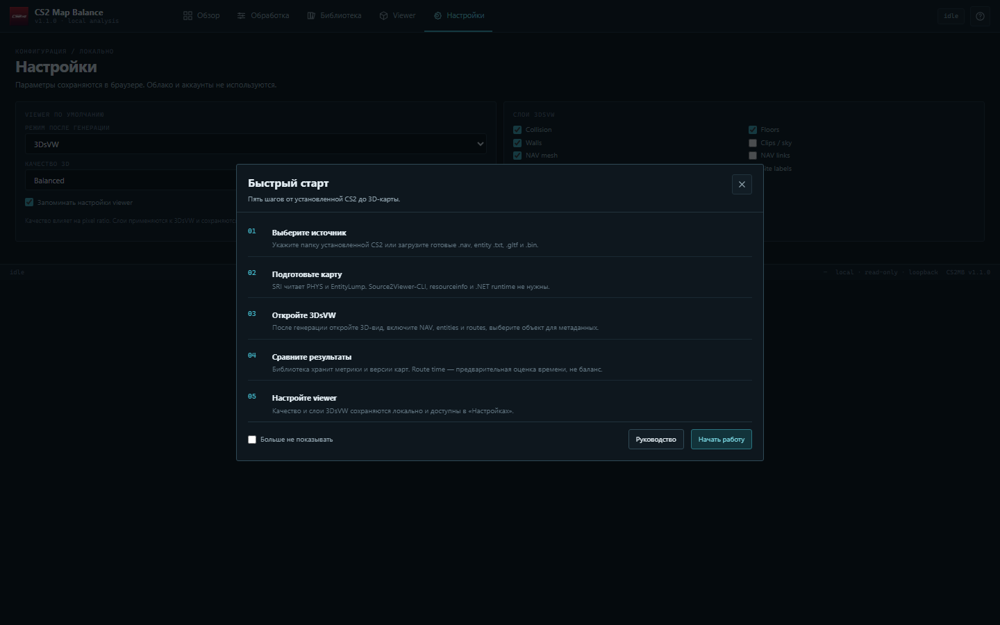
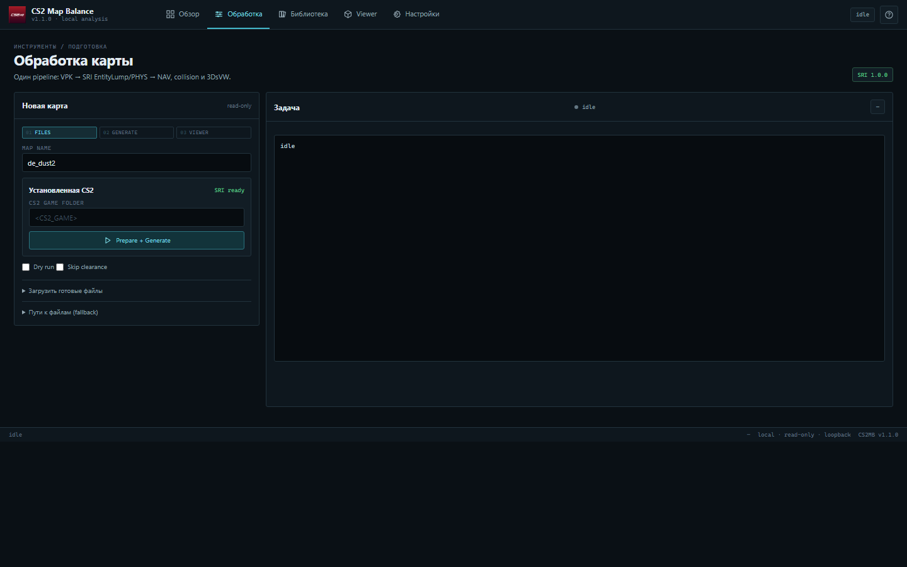
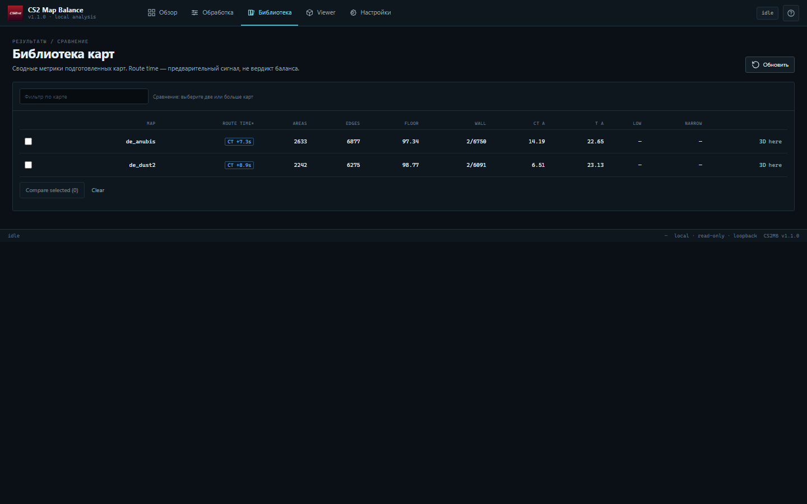
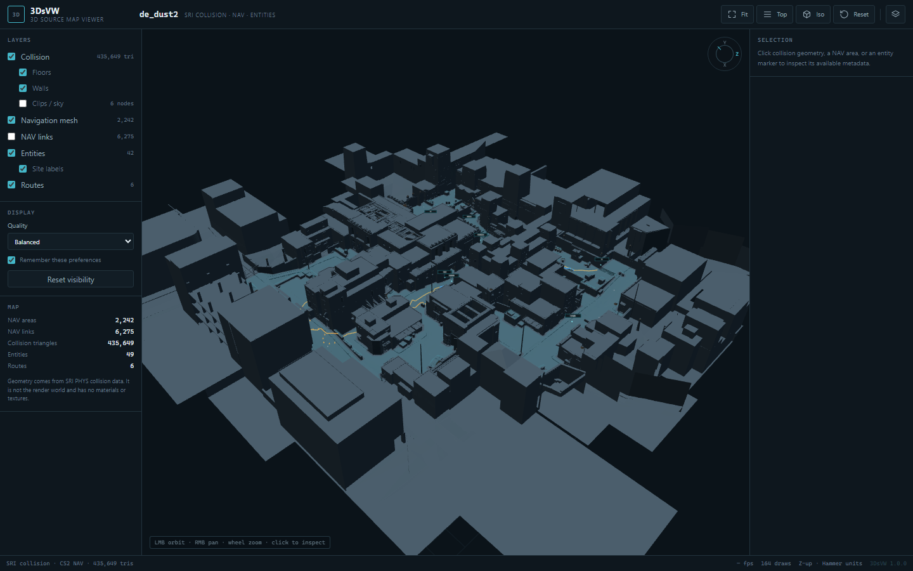
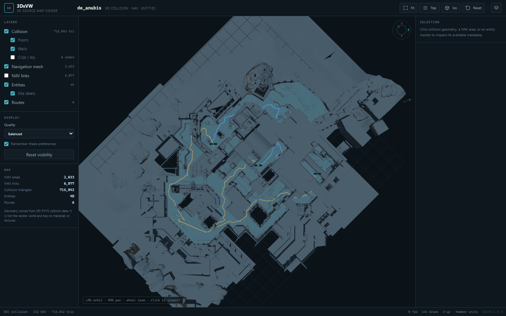
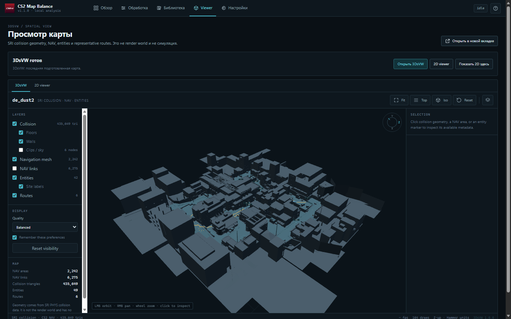
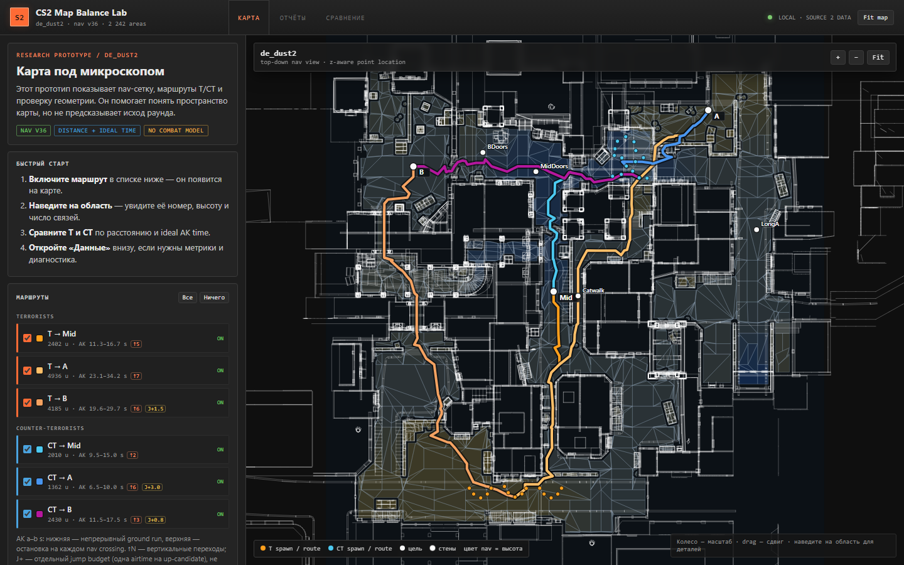
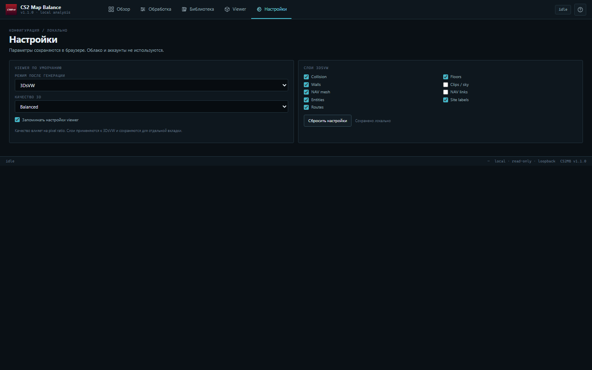

# CS2 Map Balance — руководство пользователя

**Версия:** `v1.1.1`
**Платформа:** Windows 10/11 x64 (полный пакет)
**Назначение:** локальный read-only анализ карт и 3D-визуализация

## 1. Что такое CS2MB

CS2 Map Balance превращает подготовленные данные карт Counter-Strike 2 в
проверяемые сведения о навигации, collision, маршрутах и сравнении карт. Это не
игровой сервер, не редактор карт и не предиктор баланса. Приложение не пишет в
установку CS2/Steam, не запускает игру и не взаимодействует с античитом.

Три отдельных компонента:

| Компонент | Роль |
|---|---|
| **CS2MB** | Основное приложение: приём данных, pipeline, библиотека, сравнение, настройки |
| **SRI** | Source Resource Inspector: разбор скомпилированных PHYS и EntityLump |
| **3DsVW** | 3D Source Map Viewer: браузерный пространственный просмотр |

Существующий **2D viewer** остаётся доступным для таблиц маршрутов и SVG-карты.
3DsVW — дополнительный режим, а не замена 2D viewer.

## 2. Требования

- Windows 10/11 x64.
- Полный пакет `CS2MB-v1.1.1-win-x64.zip`.
- Локальная CS2 нужна только для автоматического извлечения. Upload-режим
  работает без игры.
- Браузер с WebGL2 для 3DsVW: актуальные Chrome, Edge или Firefox.
- Для packaged build не нужны Python, `pip install`, .NET runtime,
  Source2Viewer-CLI или `resourceinfo.exe`.

## 3. Установка и запуск

1. Скачайте полный пакет со
   [страницы релиза v1.1.1](https://github.com/Shtoblam/cs2mb-tool/releases/tag/v1.1.1).
2. Сверьте архив с `SHA256SUMS.txt`.
3. Распакуйте в обычную пользовательскую папку, например
   `%USERPROFILE%\Documents\CS2MB`.
4. Запустите `Start-CS2MB.bat` (или `Start-CS2MB.ps1`).
5. Приложение откроется на <http://127.0.0.1:8765/>.

Сервер слушает только loopback. Remote binding намеренно отклоняется.

## 4. Структура приложения





- **Обзор** — рабочее пространство и последние карты.
- **Обработка** — подготовка карты из установленной CS2 или загрузка файлов.
- **Библиотека** — метрики, версии и сравнение карт.
- **Viewer** — встроенный 2D и 3DsVW.
- **Настройки** — режим viewer, качество 3D и слои по умолчанию.
- **Справка** — короткое обучение; полное руководство — этот документ.

## 5. Подготовка карты



### 5.1 Из установленной CS2 (рекомендуется)

1. Откройте **Обработка**.
2. Укажите имя карты, например `de_mirage`.
3. Укажите **CS2 game folder** — корень установки CS2, не папку `maps`.
4. Нажмите **Prepare + Generate**.

В папке должны быть:

```text
game\csgo\maps\<map>.vpk
game\csgo\gameinfo.gi
```

Закройте CS2, если VPK заблокирован. Pipeline читает VPK, извлекает NAV,
EntityLump и `world_physics.vmdl_c`, затем вызывает SRI. Результаты пишутся в
`artifacts/`, не в папку игры.

### 5.2 Загрузка готовых файлов

1. Откройте **Обработка**.
2. Разверните **Загрузить готовые файлы**.
3. Перетащите `.nav`, entity `.txt`, collision `.gltf` и `.bin`.
4. Нажмите **Generate map**.

Разрешены `.nav`, `.txt`, `.gltf`, `.bin`. Лимиты: 300 MB всего, 12 файлов,
160 MB на файл.

### 5.3 Fallback-пути

Используйте **Пути к файлам (fallback)** для файлов в `inputs/` или
`artifacts/uploads/`. Path API ограничен этими каталогами.

## 6. Что извлекает SRI

SRI поставляется в `tools/bin/sri/cs2mb-sri.exe`.

- `world_physics.vmdl_c` → PHYS → glTF + `.bin` collision-геометрия.
- `default_ents.vents_c` → EntityLump → entity text.
- Координаты остаются в Hammer units и Source axes (`x`, `y`, `z-up`).
- Сохраняются `InteractAs`, `SurfaceProperty` и `CollisionGroup`.
- Mesh и convex hull точные; sphere/capsule используют bounded tessellation.
- Путь, версия и SHA-256 SRI записываются в preparation manifest.

SRI — не универсальный просмотрщик/редактор Source 2. Он не даёт render world,
материалы и текстуры.

Проверка:

```powershell
& ".\tools\bin\sri\cs2mb-sri.exe" --version
py -3.13 tools\sri.py --status
Get-FileHash ".\tools\bin\sri\cs2mb-sri.exe" -Algorithm SHA256
```

Ожидается `cs2mb-sri 1.0.0 (SRI - Source Resource Inspector)`.

## 7. Результаты и manifest

Успешная задача пишет в `artifacts/auto/<map>/<job>/`:

- `viewer.html` — self-contained 2D viewer.
- `viewer3d/data.json` — NAV, entities, routes и collision metadata.
- `viewer3d/scene.gltf` + `scene.bin` — нормализованная collision-геометрия.
- `summary.json` — NAV, collision, маршруты и balance summary.
- `manifest.json` — provenance команд и outputs.
- `collision_floor.json`, `connection_check.json`, при необходимости
  `clearance.json`.

Manifest содержит SHA-256 входов и выходов. Личные абсолютные пути в preparation
manifest заменены на `<CS2_GAME>` и `prepared/...`.

## 8. Библиотека и сравнение



Библиотека показывает последнюю версию каждой карты:

- NAV areas и направленные связи.
- Процент соответствия пола.
- Проверки стен.
- CT/T route-time индикатор.
- Флаги clearance, где доступны.

Выберите две или больше карт и нажмите **Compare selected**. Это сводка
маршрутов и геометрии, а не вердикт баланса.

## 9. 3DsVW — 3D Source Map Viewer







3DsVW — read-only WebGL2 viewer на локально упакованном three.js. Он загружает
сгенерированный collision glTF, NAV-полигоны и отфильтрованные entity-маркеры.

### Как открыть

- Через **Viewer** после завершения задачи.
- Из строки библиотеки: `3D` открывает отдельную вкладку, `here` — встроенный вид.
- Вкладка **3DsVW** в приложении использует ту же реализацию.

### Что показывается

- **Collision** из SRI PHYS, разделённая по ориентации граней на полы, стены и
  прочие поверхности.
- **Clips / sky** — скрыты по умолчанию.
- **NAV mesh** — полупрозрачные полигоны и, отдельно, направленные связи.
- **Entities** — спавны CT/T, метки сайтов и выбранные объекты.
- **Routes** — представительные маршруты CT/T к A, B и Mid.

Это **не** render-world геометрия и не материалы/текстуры. Форма карты — честная
визуализация доступных collision-данных, а не скриншот игры.

### Камера

- ЛКМ — orbit.
- ПКМ — pan.
- Колесо — zoom.
- **Fit** (`F`) — вписать игровую область.
- **Top** (`T`) — вид сверху.
- **Iso** (`I`) — изометрический вид.
- **Reset** (`R`) — сброс камеры.
- **New tab** — та же карта в отдельной вкладке.

### Слои и инспектор

Слева переключаются collision, floors, walls, clips/sky, NAV mesh, NAV links,
entities, site labels и routes. **Reset visibility** возвращает значения по
умолчанию.

Клик по collision, NAV-полигону или entity показывает доступные метаданные.
Инспектор не придумывает имена, поверхности или свойства.

### Производительность

3DsVW рендерит по требованию, использует frustum culling и группирует collision
в небольшое число draw calls. Локальные измерения:

| Карта | Collision triangles | NAV areas | Draw calls |
|---|---:|---:|---:|
| de_dust2 | 435,649 | 2,242 | 164 |
| de_anubis | 715,842 | 2,633 | 141 |

Это локальные измерения в Edge на референсном ПК, не универсальный benchmark.
На слабых GPU используйте preset **Performance**.

## 10. 2D viewer



2D viewer доступен из **Viewer**. Он содержит NAV-полигоны, representative и all
spawn-to-target маршруты, таблицы, collision-проверки и диагностику. Это
self-contained HTML, работает offline.

3DsVW и 2D — два представления одних и тех же сгенерированных данных.

## 11. Настройки



Настройки хранятся в `localStorage` браузера; аккаунт и облако не используются.

- **Viewer mode** — 3DsVW или 2D после генерации.
- **3D quality** — Performance (pixel ratio 1), Balanced (до 1.5), Quality (до 2).
- **Default layers** — collision, floors, walls, clips, NAV, NAV links, entities,
  site labels, routes.
- **Remember settings** — если выключено, настройки действуют только в сессии.
- **Reset settings** — сброс.

Те же настройки применяются к встроенному и отдельному viewer.

## 12. Устранение неполадок

| Симптом | Действие |
|---|---|
| `SRI not installed` | Используйте полный пакет; проверьте `tools\bin\sri\cs2mb-sri.exe`. |
| `SRI failed` | Проверьте `artifacts/.../prepared/sri.log`; убедитесь в поддержке сборки CS2. |
| `invalid CS2 folder` | Выберите корень CS2 с `game\csgo\maps`. |
| `too many active jobs` | Дождитесь завершения задачи; лимит — две. |
| `missing Origin header` | Используйте локальный UI; прямые non-browser POST отклоняются. |
| 3D требует WebGL2 | Используйте актуальный Chrome, Edge или Firefox с аппаратным ускорением. |
| 3D пустой | Проверьте `viewer3d/data.json` и `scene.gltf`; смотрите console и server log. |
| `no .bin` | Загружайте `.gltf` и `.bin` вместе. |
| Порт занят | Запустите с `--port 8766`. |

## 13. Данные, приватность и безопасность

- Установка игры используется только для чтения.
- В viewer нет телеметрии, внешних загрузок и runtime CDN.
- Локальный сервер слушает только loopback, проверяет Host и Origin.
- Uploads ограничены и фильтруются по расширениям; отклонённые удаляются.
- Данные viewer отдаются из ограниченных путей внутри каталога задачи.
- 3DsVW выводит метаданные как текст и не вставляет их как HTML.
- SRI — локальный доверенный бинарник; сверяйте SHA-256. Он не подписан
  code-signing сертификатом.
- Извлечённые ресурсы игры остаются собственностью Valve; их нельзя
  распространять.

Модель безопасности и остаточные риски: [SECURITY.ru.md](SECURITY.ru.md).

## 14. Ограничения

- SRI и пакет — только Windows x64.
- 3DsVW показывает collision-геометрию, а не render world.
- Кривые collision-примитивы тесселируются приближённо.
- NAV — абстракция для ботов, не точный player collision.
- Route time — оценка, не измеренное игровое время и не баланс матча.
- Movement-модель покрывает straight-line ground motion; нет combat, utility,
  visibility, ladders и решений игроков.
- Поддержка форматов привязана к записанной сборке CS2; будущие изменения Valve
  могут потребовать обновления SRI.
- В 3DsVW нет box selection, измерений и редактирования. Это viewer.
